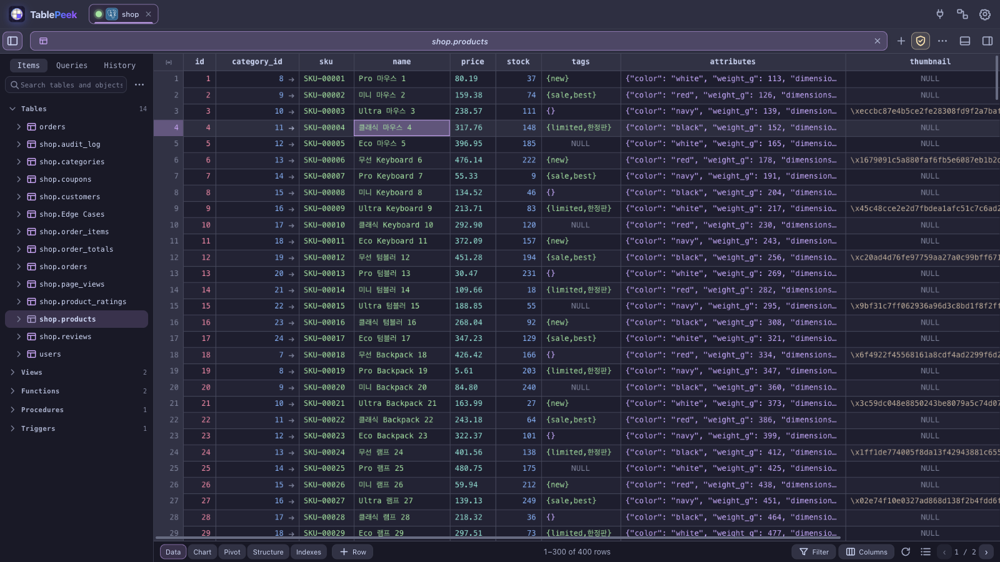
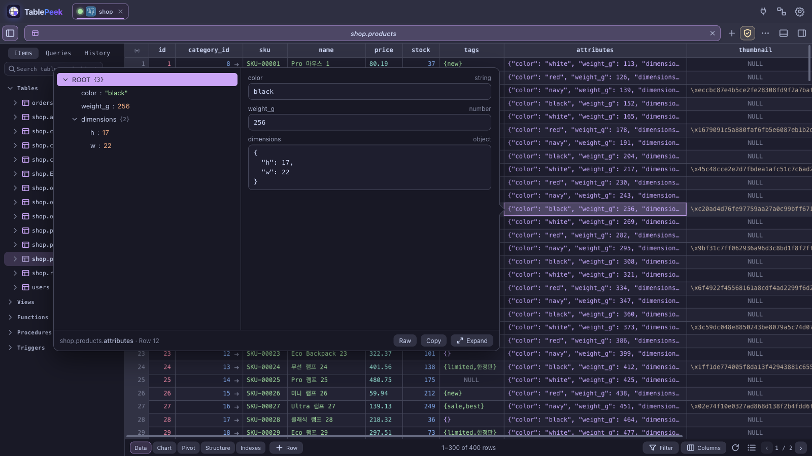
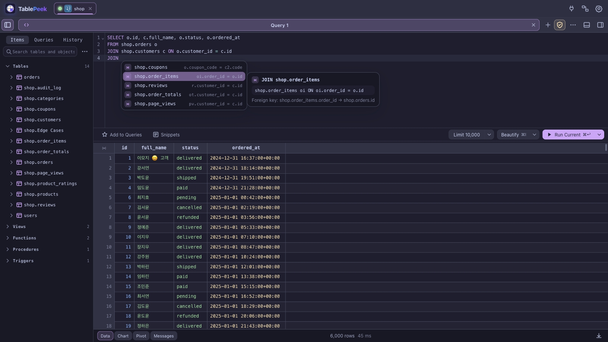
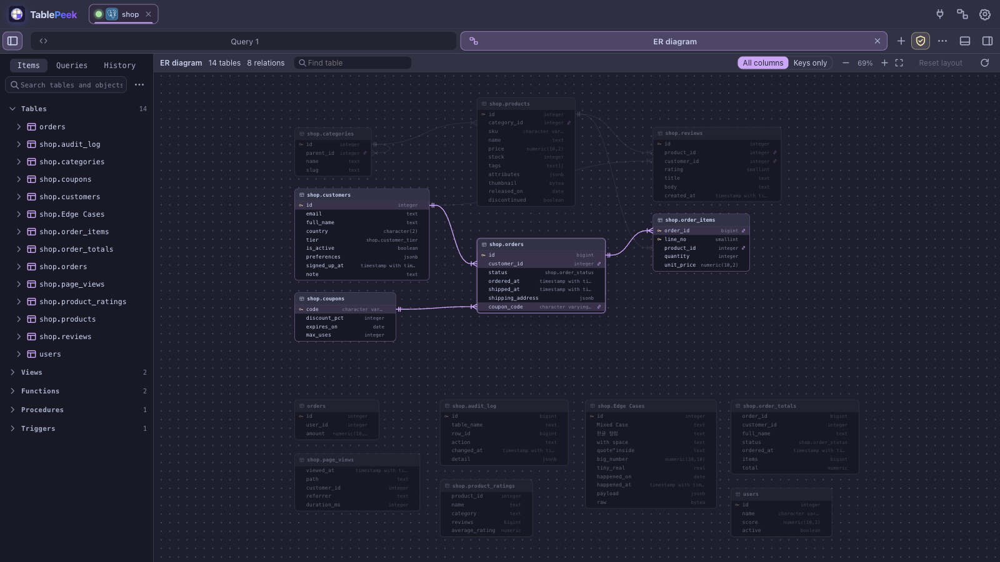
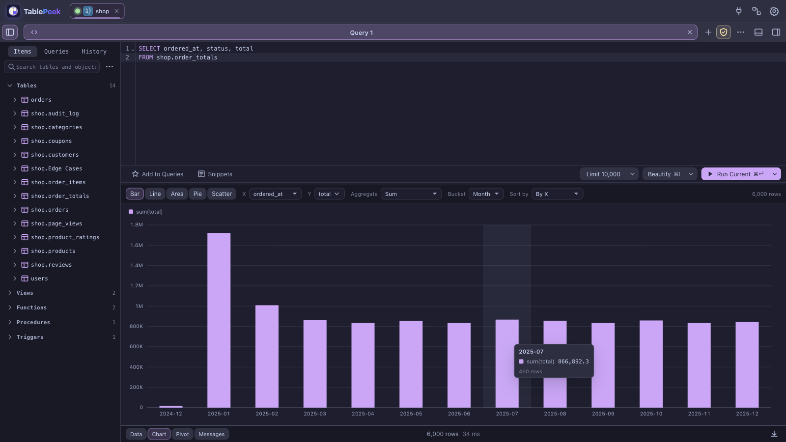

# TablePeek

**A fast, local-first database client for macOS, Windows, and Linux.**

Query, browse, and edit SQLite, PostgreSQL, MySQL/MariaDB, CockroachDB, SQL Server, Oracle, ClickHouse, Cassandra, ScyllaDB, MongoDB, Elasticsearch, and OpenSearch from one app. Everything runs on your machine: no account, no cloud relay.



- **Fast on big results.** Rows stream in and render on a canvas grid; queries can be cancelled.
- **Safe edits.** Cell edits go through the primary key, with explicit transactions and a safe mode for `UPDATE`/`DELETE` without `WHERE`.
- **Smart SQL editor.** Completion for columns, joins from foreign keys, functions, and templates.
- **Inspect anything.** Quick Look for JSON trees, hex, and the row a foreign key points to; an ER diagram; charts and pivots.
- **Write SQL with AI, your own model.** Opt-in: describe a query (`⌘E`) and the SQL for the connection's schema is written into the editor for you to accept or reject, or let it suggest as you type, from the model you pick across your ChatGPT subscription, the Codex CLI or Claude Code CLI signed in on your machine, or a Gemini API key (more ways coming soon). Rows are never sent, and nothing runs until you do.
- **Import and export.** CSV, JSON, XML, and SQL, plus dump and restore, as background jobs.
- **Secure by default.** Loopback only, passwords in the OS keychain, TLS and SSH tunnels.

## Install

**macOS**

```sh
brew install --cask extransload/tap/tablepeek
```

**Windows**: download `TablePeek-…-setup.exe` from [Releases](https://github.com/Extransload/TablePeek/releases/latest) and run it.

**Command line** (macOS, Linux, Windows): download the `tablepeek-…` archive for your platform from [Releases](https://github.com/Extransload/TablePeek/releases/latest), unpack it, and run:

```sh
./tablepeek serve
```

It opens TablePeek in your browser. Add `--demo` to try it with sample data.

> The builds are not signed with a paid certificate, so the first launch of a downloaded file needs one extra click. Homebrew handles that for you. See [the install guide](docs/INSTALL.md) for details, updating, and building from source.

## Screenshots

| Quick Look | SQL completion |
|---|---|
|  |  |
| Any cell as a JSON tree, hex, or the row it references | Joins from foreign keys, with an info panel |
| **ER diagram** | **Charts and pivots** |
|  |  |
| Tables and relations laid out automatically | Bar, line, pie, and pivot views of any result |

## Documentation

- [Install guide](docs/INSTALL.md): every download, first launch, updating, the update check
- [User guide](docs/GUIDE.md): databases and connection options, features, writing SQL with AI, MCP for AI clients, security
- [Development](docs/DEVELOPMENT.md): architecture, building from source, tests, project layout
- [Changelog](CHANGELOG.md): what each release changed
