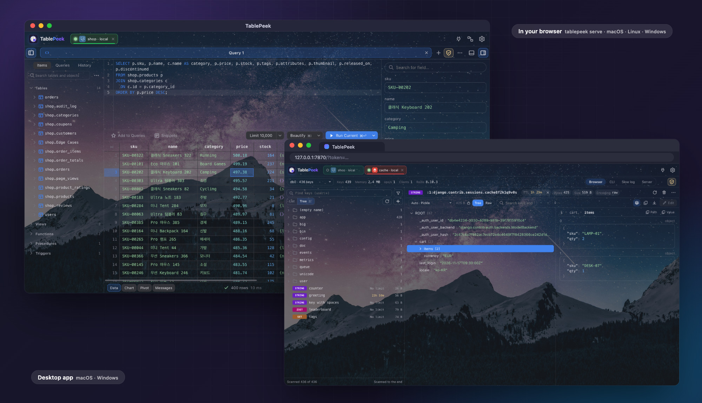
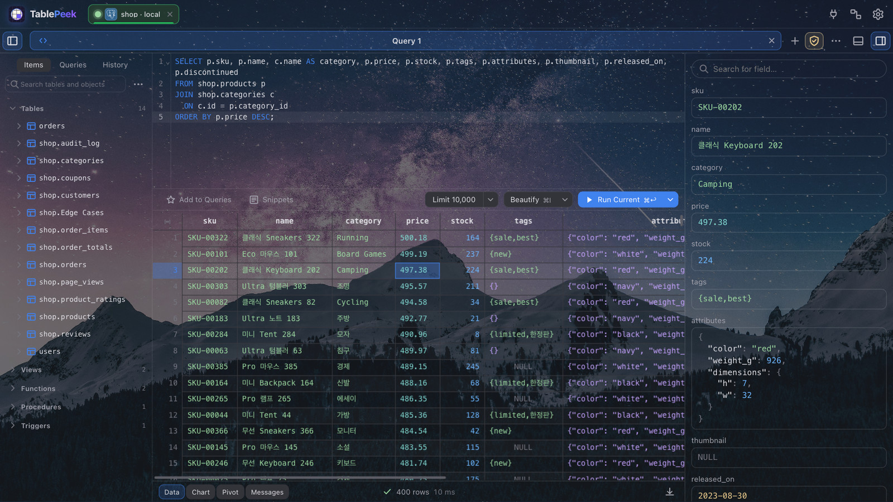
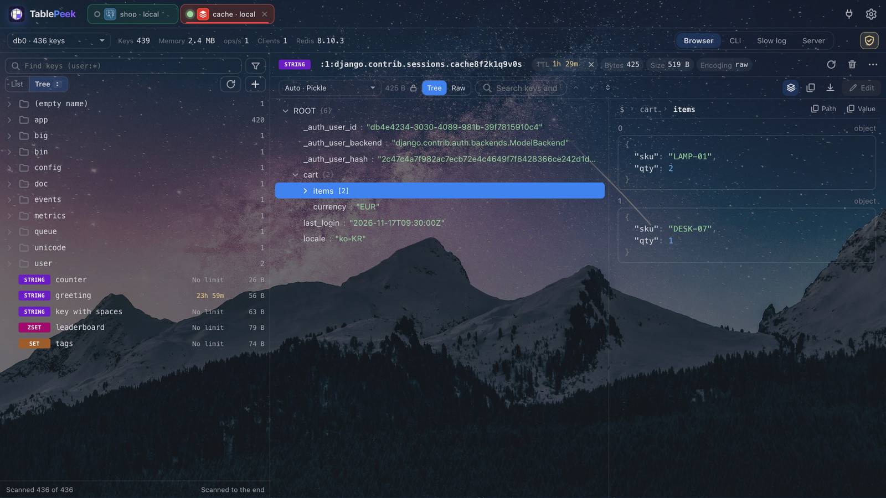
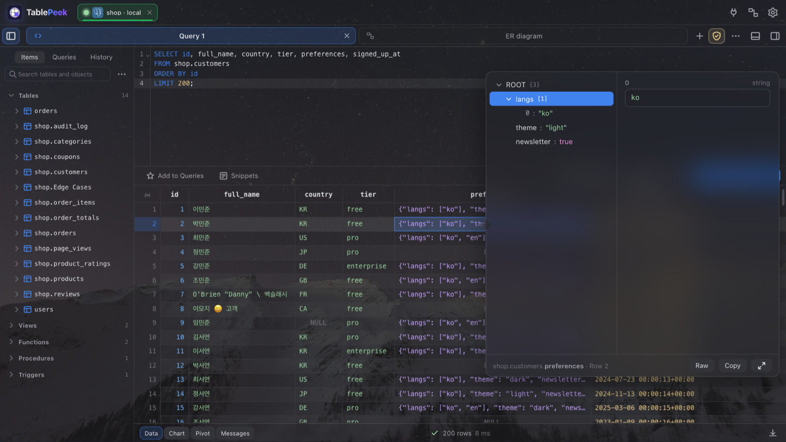
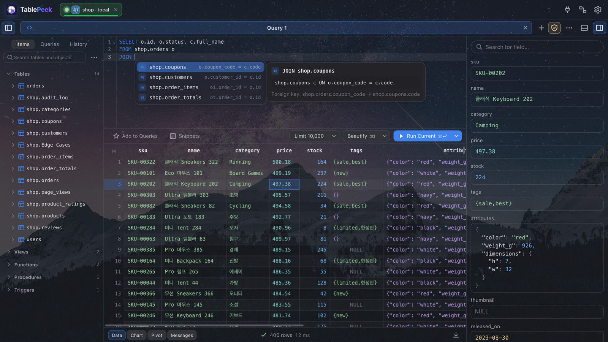
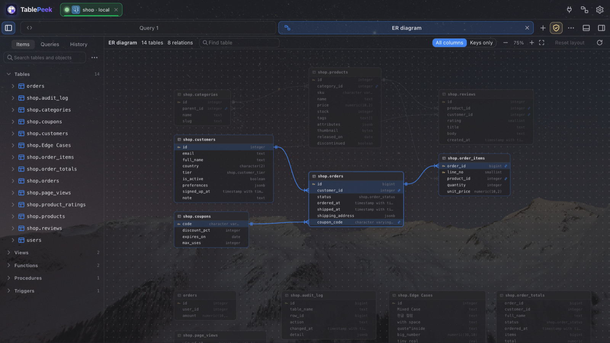
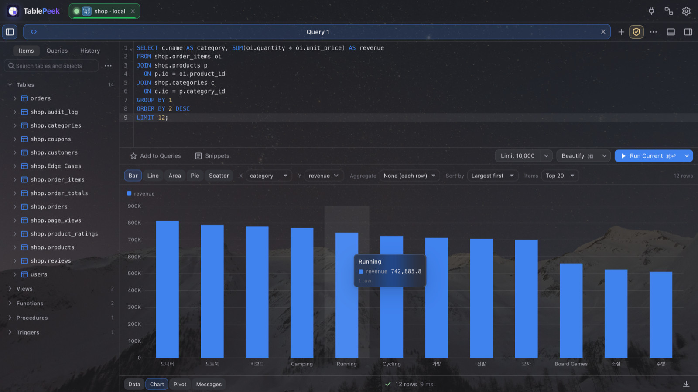
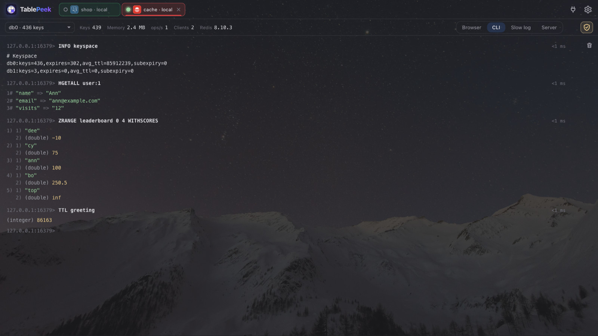
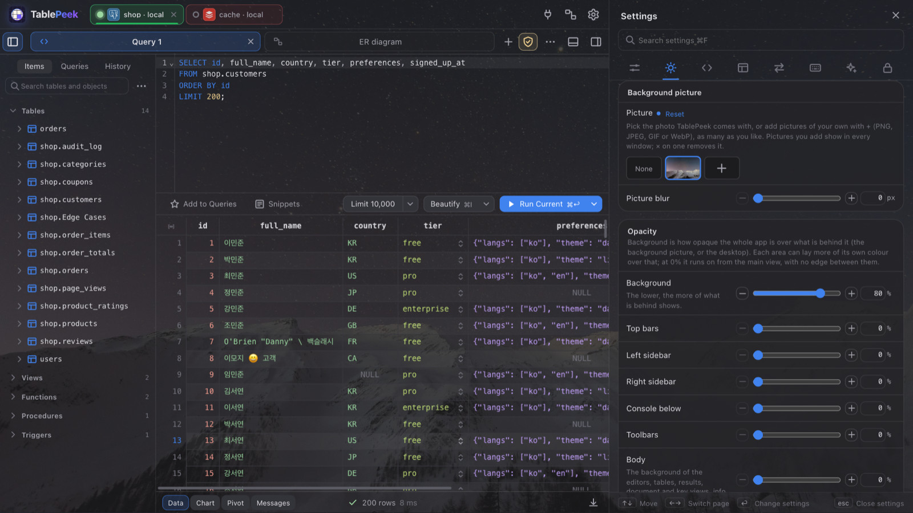

<div align="center">

# TablePeek

**A fast, local-first database client, as a desktop app or in your browser.**

[](https://github.com/Extransload/TablePeek/actions/workflows/ci.yml) [](https://github.com/Extransload/TablePeek/releases/latest) [](LICENSE)

[Install](#install) · [Features](#features) · [Screenshots](#screenshots) · [Documentation](#documentation) · [Changelog](CHANGELOG.md)



</div>

Query, browse and edit **PostgreSQL, MySQL/MariaDB, SQLite, SQL Server, Oracle, CockroachDB, ClickHouse, Cassandra, ScyllaDB, MongoDB, Elasticsearch, OpenSearch and Redis/Valkey** from one place. Everything runs on your machine: no account, no cloud relay. The interface is in English and Korean.

## Two ways to run it, one TablePeek

|  | Desktop app | In your browser |
|---|---|---|
| **Platforms** | macOS (Apple silicon), Windows | macOS, Linux, Windows |
| **Install** | `brew install --cask extransload/tap/tablepeek`, or the Windows installer | Unpack the `tablepeek` archive and run `./tablepeek serve` |
| **Window** | Its own window, solid, glass or see-through | A tab in the browser you already use |
| **Updates** | Downloads, checks the signature, and restarts into the new version | Tells you a new release is out |
| **Shortcuts** | Mac-style tab keys (`⌘T`, `⌘W`, `⇧⌘[` `]`), kept apart | Browser-safe keys (`⌥T`, `⌥W`, `⌥[` `]`), kept apart |

Both are the same app, served by the same local server: saved connections, settings, themes and history live in `~/.tablepeek`, and the open connections and their tabs come back after an update or a restart. Passwords stay in the OS keychain.

## Install

**macOS** (Apple silicon)

```sh
brew install --cask extransload/tap/tablepeek
```

**Windows**: run `TablePeek-…-setup.exe` from the [latest release](https://github.com/Extransload/TablePeek/releases/latest). It installs for the current user, without admin rights.

**In the browser** (macOS, Linux, Windows): download the `tablepeek-…` archive for your platform from the [latest release](https://github.com/Extransload/TablePeek/releases/latest), unpack it, and run:

```sh
./tablepeek serve          # opens TablePeek in your browser
./tablepeek serve --demo   # with a sample database to look around
```

> The builds are not signed with a paid certificate, so the first launch of a downloaded file needs one extra click; Homebrew handles that for you. The [install guide](docs/INSTALL.md) covers every download, first launch, updating, and building from source.

## Features

**Work with data**
- **Fast on big results.** Rows stream in and draw on a canvas grid; any query can be cancelled.
- **Safe edits.** Cells change through the primary key, with explicit transactions, and safe mode asks before an `UPDATE` or `DELETE` without `WHERE` (or `EXPLAIN ANALYZE` on a write).
- **Smart SQL editor.** Completion for tables, columns, functions and joins from foreign keys; beautify, snippets, saved queries and history.
- **Inspect anything.** Quick Look turns any cell into a JSON tree, hex, or the row a foreign key points to; charts and pivots of any result; an ER diagram laid out for you.
- **Import and export.** CSV, JSON, XML and SQL, plus dump and restore, as background jobs.

**Every kind of database**
- **SQL engines** share one workbench, each with its own dialect, plans and server tools.
- **MongoDB** gets cards, JSON and table views, an aggregation builder, schema analysis, indexes, a mongosh tab and change streams.
- **Elasticsearch and OpenSearch** get index browsing, Query DSL and SQL, a Dev Tools console, mappings and cluster views.
- **Redis and Valkey** get a RedisInsight-style browser: a key tree, an editor per type, a terminal-style CLI, slow log and server info. Values decode as JSON, MessagePack, Python pickle (Django sessions), PHP and Java serialized data, Protobuf, vectors, timestamps and more.

**Make it yours**
- **Themes and a background picture.** Light, dark or the system's, with dozens of themes, syntax and value colours per theme, and a photo behind the app. Every area's opacity has its own slider.
- **Text size where you are.** `⌘+`, `⌘−` and `⌘0` size the editor, the table or the interface, whichever has focus.
- **Keyboard first.** Every setting steps with ▲ ▼ or takes a typed number; every shortcut can be rebound.
- **Motion that helps.** Trees and sections open and close smoothly, and Reduce motion turns it all off.

**AI, on your terms**
- **Write SQL with AI.** Opt-in and off by default. Press `⌘E`, describe a query, and the SQL for the connection's schema is written into the editor for you to accept or reject, or suggested as you type. Use your ChatGPT subscription, the Codex CLI on your machine, or a Gemini API key. Rows are never sent, and nothing runs until you do.
- **MCP for AI clients.** `tablepeek mcp` lets an AI client such as Claude Desktop list connections, read the schema and run read-only queries against a running TablePeek.

**Secure by default.** The server listens on loopback only, behind a per-run token; passwords live in the OS keychain; TLS, client certificates, and SSH or HTTP tunnels for every engine that takes them.

## Screenshots

| SQL results and row detail | Redis, with a pickled Django session decoded |
|---|---|
|  |  |
| **Quick Look** | **SQL completion** |
|  |  |
| **ER diagram** | **Charts and pivots** |
|  |  |
| **Redis CLI, terminal style** | **Appearance: background picture and per-area opacity** |
|  |  |

## Documentation

- [Install guide](docs/INSTALL.md): every download, first launch, updating, the update check
- [User guide](docs/GUIDE.md): databases and connection options, every workbench, settings and shortcuts, writing SQL with AI, MCP, security
- Engine guides: [MongoDB](docs/MONGODB.md), [Oracle](docs/engines/oracle.md), [ClickHouse](docs/engines/clickhouse.md), [Cassandra and ScyllaDB](docs/engines/cassandra.md), [Elasticsearch and OpenSearch](docs/engines/elasticsearch.md), [Redis and Valkey](docs/engines/redis.md)
- [MCP](docs/MCP.md): setting up `tablepeek mcp`, its tools, and its limits
- [Development](docs/DEVELOPMENT.md): architecture, building from source, tests, project layout
- [Contributing](CONTRIBUTING.md) · [Security](SECURITY.md) · [Changelog](CHANGELOG.md)

## License

TablePeek is free software under the [GNU Affero General Public License v3.0](LICENSE), version 3 only (`AGPL-3.0-only`). Copyright © 2026 Extransload.

You may use, study, change and share it. If you distribute a changed version, or let other people use a changed version over a network, you must offer them its complete source under the same license. The bundled Oracle driver (`crates/vendor/oracledb`) keeps its own license (UPL-1.0 OR Apache-2.0), and every other library keeps its own.
