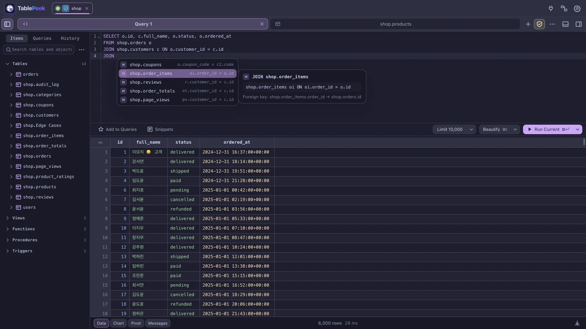
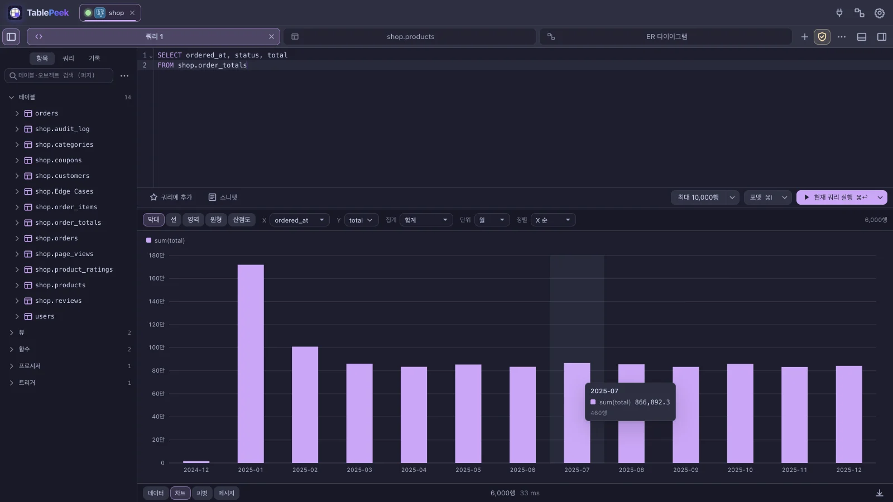
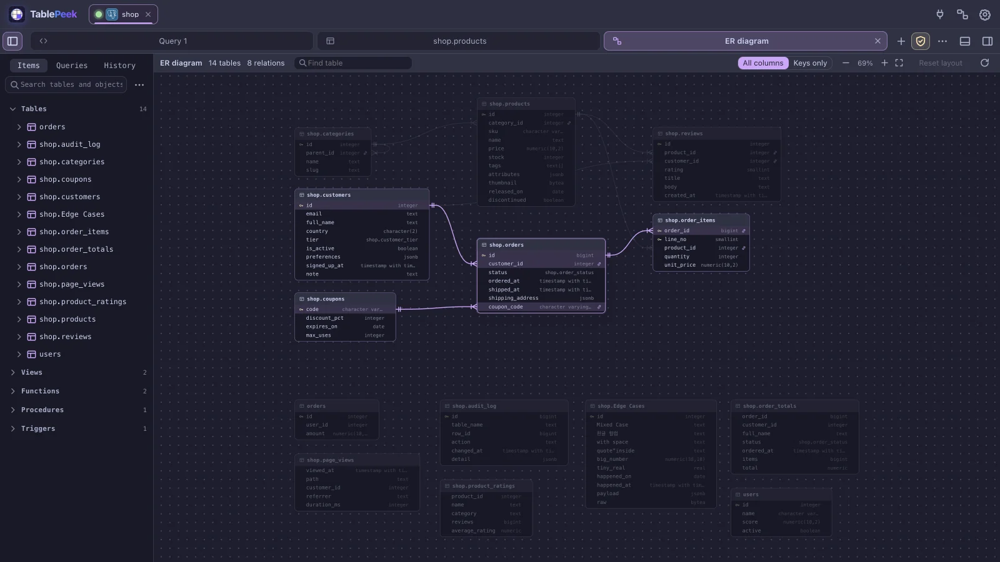
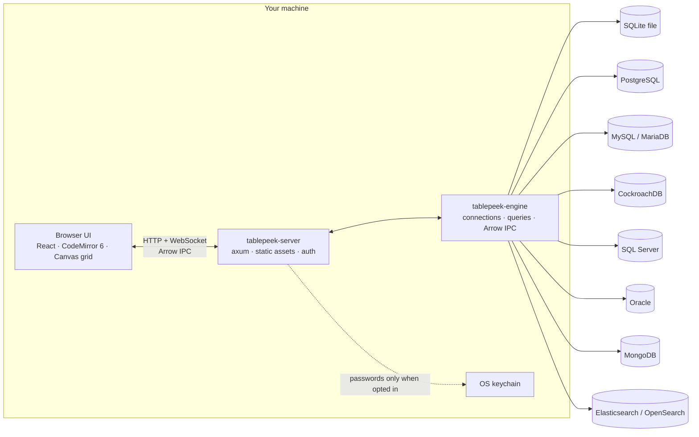

# TablePeek

**A fast, local-first database client that runs in your browser.**

TablePeek pairs a Rust query engine with a browser UI. Open SQLite files or connect to PostgreSQL, MySQL/MariaDB, CockroachDB, SQL Server, Oracle, ClickHouse, Cassandra, ScyllaDB, MongoDB, Elasticsearch, and OpenSearch. Query, inspect, edit, and explore data without a cloud relay or a heavyweight desktop shell.


## At a glance

| | |
|---|---|
| **Databases** | SQLite, PostgreSQL, MySQL/MariaDB, CockroachDB, SQL Server, Oracle, ClickHouse, Cassandra, ScyllaDB, MongoDB, Elasticsearch, OpenSearch |
| **Runtime** | Local Rust engine + browser UI |
| **Transport** | HTTP + WebSocket, Arrow IPC streaming |
| **Editing** | Primary-key cell edits, row insert/delete, transactions, `DEFAULT`/`NOW()` set on the server |
| **Transfer** | CSV/JSON import, CSV/JSON/XML/SQL export, SQL dump and restore, all as cancellable background jobs |
| **Security** | Loopback-only, per-run token, OS keychain, TLS/mTLS, SSH tunnels, encrypted connection exports |
| **Themes** | 50 built-in themes + Base16/VS Code theme import |

## Why TablePeek

- **Local by design.** The engine binds to `127.0.0.1` and stops there. There is no hosted backend and no cloud relay; direct connections and SSH tunnels run from your machine to the database.
- **Built for real result sets.** Results stream as Arrow IPC and render on a canvas grid that only paints visible cells. Queries are cancellable, and large tables are fetched in windows instead of loaded all at once.
- **Five engines, one workflow.** Use the same grid, editor, schema browser, and Quick Look across SQLite, PostgreSQL, MySQL/MariaDB, CockroachDB, and SQL Server.
- **Edits with guardrails.** Cell updates target a single row through its primary key. Row inserts and deletes are explicit, and transaction state is tracked per session.
- **Inspect, don't guess.** Open any cell in Quick Look for a full value editor, a structured JSON tree, encoding/HEX views, and, for a foreign key, the row it points to.
- **Long work stays out of the way.** Imports, exports, dumps, and restores run as background jobs with progress and a stop button, and never cancel the queries the page is running.
- **Behaves like a desktop app.** Native-feeling menus, per-area fonts, thin scrollbars, 50 themes, and a settings screen organised by the part of the screen it changes.
- **AI access without write access.** The built-in MCP server exposes schema discovery and read-only queries over stdio.

## Quick start

There are two ways to get TablePeek: download a prebuilt binary from [GitHub Releases](https://github.com/Extransload/TablePeek/releases), or build it from source. Both give the same program; the binary carries the web UI inside it, so there is nothing else to install. SQLite is bundled and TLS uses rustls, so there is no OpenSSL or database client library to install either. macOS and Windows are the primary targets; Linux uses the same stack.

### Download a binary

Each release has one archive per platform, plus a `SHA256SUMS` file:

| Platform | Archive |
|---|---|
| macOS, Apple silicon | `tablepeek-vX.Y.Z-aarch64-apple-darwin.tar.gz` |
| macOS, Intel | `tablepeek-vX.Y.Z-x86_64-apple-darwin.tar.gz` |
| Linux, x86_64 | `tablepeek-vX.Y.Z-x86_64-unknown-linux-gnu.tar.gz` |
| Linux, arm64 | `tablepeek-vX.Y.Z-aarch64-unknown-linux-gnu.tar.gz` |
| Windows, x86_64 | `tablepeek-vX.Y.Z-x86_64-pc-windows-msvc.zip` |

Each archive holds a `tablepeek-vX.Y.Z-<platform>` folder with the `tablepeek` binary (`tablepeek.exe` on Windows) and this README. The binaries are not signed or notarized, and there is no installer: you unpack the archive and run the binary.

**macOS and Linux**

```sh
VERSION=v0.1.0                    # the latest release
TARGET=aarch64-apple-darwin       # or x86_64-apple-darwin, x86_64-unknown-linux-gnu, aarch64-unknown-linux-gnu
curl -LO "https://github.com/Extransload/TablePeek/releases/download/$VERSION/tablepeek-$VERSION-$TARGET.tar.gz"
tar -xzf "tablepeek-$VERSION-$TARGET.tar.gz"
cd "tablepeek-$VERSION-$TARGET"
./tablepeek serve
```

> **macOS: "cannot be opened because Apple cannot check it for malicious software".** The binary is not notarized, so Gatekeeper stops it when the archive came through a web browser, which marks the download as quarantined. Clear the mark once with `xattr -d com.apple.quarantine tablepeek` (in the unpacked folder), or try to run it, then pick **Open Anyway** under System Settings > Privacy & Security. Archives fetched with `curl` as above are not quarantined, and `xattr` then answers "No such xattr", which is harmless.

The Linux binaries need glibc 2.39 or later (Ubuntu 24.04, Debian 13, Fedora 40, or newer) and, to save passwords, a Secret Service keyring such as GNOME Keyring or KWallet over D-Bus (`libdbus-1-3`, present on desktop installs). On an older distribution, [build from source](#build-from-source).

To run `tablepeek` from anywhere, move it onto your `PATH`, for example `mv tablepeek ~/.local/bin/` or `sudo mv tablepeek /usr/local/bin/`.

**Windows**

1. Download `tablepeek-vX.Y.Z-x86_64-pc-windows-msvc.zip` from the [latest release](https://github.com/Extransload/TablePeek/releases/latest) and extract it (right-click > Extract All).
2. Open PowerShell in the extracted folder and run:

   ```powershell
   .\tablepeek.exe serve
   ```

   If SmartScreen or PowerShell blocks the unsigned binary, run `Unblock-File .\tablepeek.exe` once, or choose **More info > Run anyway** in the SmartScreen dialog.

`tablepeek serve` starts the server on a free port, prints a tokenized loopback URL (keep it private), and opens your browser on the connection home. Options: `--port 7870` for a fixed port (the one [`tablepeek mcp`](#mcp-for-ai-clients) expects by default), `--demo` for an in-memory demo database, `--db <file>` to open a SQLite file, `--no-open` to leave the browser alone. `tablepeek --version` prints the version, the commit it was built from, and whether it is a release or a source build.

**Verify the download (optional).** Download `SHA256SUMS` from the same release into the folder with the archive, then:

```sh
shasum -a 256 --check --ignore-missing SHA256SUMS      # macOS
sha256sum --check --ignore-missing SHA256SUMS          # Linux
```

```powershell
Get-FileHash .\tablepeek-vX.Y.Z-x86_64-pc-windows-msvc.zip -Algorithm SHA256   # compare with its line in SHA256SUMS
```

### Build from source

Building needs two toolchains: **Rust** (`cargo`, for the server) and **Node.js 20+** (`npm`, for the web bundle).

#### 1. Install the toolchains

**macOS**

```sh
xcode-select --install                                          # C compiler and linker (skip if already installed)
curl --proto '=https' --tlsv1.2 -sSf https://sh.rustup.rs | sh  # Rust: cargo, rustc
brew install node                                               # Node.js 20+ (or the installer from nodejs.org)
```

**Windows**

1. Download and run `rustup-init.exe` from [rustup.rs](https://rustup.rs). When it offers to install the Visual Studio C++ Build Tools, accept: Rust uses that linker on Windows.
2. Install Node.js 20+ (LTS) from [nodejs.org](https://nodejs.org).

**Linux (Debian/Ubuntu)**

```sh
sudo apt install build-essential pkg-config libdbus-1-dev       # compiler; D-Bus headers for the password keyring
curl --proto '=https' --tlsv1.2 -sSf https://sh.rustup.rs | sh
```

Install Node.js 20+ from [nodejs.org](https://nodejs.org) or a version manager such as nvm; distribution packages are often older.

Then **open a new terminal** and check both tools:

```sh
cargo --version
node --version    # v20 or later
```

> `cargo: command not found` right after installing Rust means the terminal predates the installer's PATH change. Open a new terminal, or on macOS/Linux run `source "$HOME/.cargo/env"`.

#### 2. Build and run

macOS / Linux:

```sh
git clone https://github.com/Extransload/TablePeek.git
cd TablePeek
make install
make run
```

Windows has no `make`, so run the same steps in PowerShell:

```powershell
git clone https://github.com/Extransload/TablePeek.git
cd TablePeek
cd web; npm install; npm run build; cd ..
cargo run -p tablepeek -- serve --port 7870
```

The first build compiles every Rust dependency and takes a few minutes; later starts take seconds.

`make run` builds the web bundle and Rust binary, starts the server, and opens the browser on the connection home, where you add your first connection. The console prints a tokenized loopback URL; keep that URL private.

To look around with sample data first, start with an in-memory demo database:

```sh
make run DEMO=1
# Windows: cargo run -p tablepeek -- serve --demo
```

Open an existing SQLite file:

```sh
make run DB=/absolute/path/to/app.sqlite
# Windows: cargo run -p tablepeek -- serve --db C:\path\to\app.sqlite
```

Useful options:

```sh
make run PORT=7871                 # default port is 7870
make run DEMO=1 DEMO_ROWS=500000   # demo database with more rows, up to 2,000,000
make run NO_OPEN=1                 # do not open a browser automatically
make help                          # full command list
```

## Updating

TablePeek tells you when a newer release is out: a notice at the top of the app names the new version, links to its changes, and opens the update steps for the way your copy was installed. It checks GitHub Releases at most once a day, says nothing when offline, and can be turned off under Settings > General > **Check for new versions**; [Update check](#update-check) describes exactly what it sends. Versions follow [Semantic Versioning](https://semver.org) and every change is listed in [CHANGELOG.md](CHANGELOG.md).

**A downloaded binary.** Quit TablePeek, download the archive for the new version as in [Download a binary](#download-a-binary), and replace the old `tablepeek` binary with the new one (on macOS, clear the quarantine mark again). Your connections and settings live in `~/.tablepeek` and the OS keychain, not next to the binary, so they carry over.

**A source build.** Pull and rebuild, then restart the server:

```sh
git pull
make build           # or make run; Windows: cd web; npm install; npm run build; cd ..; cargo build -p tablepeek
```

To build a particular release rather than the latest commit, check out its tag, for example `git checkout v0.1.0`. `tablepeek --version` shows which version and commit you are running.

## Update check

The server, not the page, asks GitHub whether a newer release is out. When the app opens it asks the server for the update status; the server checks only if checks are on and the last check is at least 24 hours old (Settings > General > **Check now** checks right away).

- **What is sent.** One unauthenticated `GET https://api.github.com/repos/Extransload/TablePeek/releases/latest` with `User-Agent: TablePeek/<version>` and `Accept: application/vnd.github+json`, with a 5-second timeout. Nothing else: no identifier, no connection or usage data, no cookies. GitHub sees your IP address as with any request.
- **What is kept.** `~/.tablepeek/update.json` holds the setting, the release you chose to skip, the time of the last check and what it found (tag, release page, publish date, the start of the release notes, the archive names). Delete it to start over.
- **What counts as newer.** Tags are compared as [Semantic Versioning](https://semver.org); drafts and prereleases (`v0.2.0-rc.1`) are never offered. **Skip this version** hides the notice for that release only; closing it hides it until the next launch.
- **Failures are quiet.** Offline, a timeout, an HTTP error or GitHub's rate limit leaves the app silent; Settings > General shows why the last check failed.
- **Turning it off.** Clear Settings > General > **Check for new versions** (kept in `update.json`), or start the server with `TABLEPEEK_NO_UPDATE_CHECK=1` (any value but empty or `0`), which wins over the setting; CI and packagers can use it. Either way no request is made at all.
- **Mirrors.** `TABLEPEEK_UPDATE_URL` replaces the GitHub URL with any endpoint answering in the shape of GitHub's latest-release API (`tag_name`, `html_url`, `published_at`, `body`, `draft`, `prerelease`, `assets[].name`, `assets[].browser_download_url`). The tests use it to point the check at a local server.

`tablepeek --version` and `GET /api/version` report the version, the commit it was built from (`-dirty` with uncommitted changes) and whether it is a `release` binary or a `source` build.

## Database connections

Create connections from the in-app connection screen. Profiles are saved in `~/.tablepeek/store.json` without passwords; a saved password is stored in the operating system keychain (the default for new connections; pick "ask every time" to type it on each connect).

| Driver | Connect to | Notes |
|---|---|---|
| **SQLite** | Local file or in-memory demo | Saved connection profiles with a database path (native file dialog), quick open from the file picker, `--db`, or the built-in demo |
| **PostgreSQL** | PostgreSQL servers | `ssl_mode=disable/prefer/require`, CA certificates, mTLS client certificates |
| **MySQL** | MySQL and MariaDB | TLS `prefer`/`require`, CA certificates, mTLS client certificates |
| **CockroachDB** | CockroachDB clusters | PostgreSQL wire protocol; internal tables are excluded from schema browsing |
| **SQL Server** | Microsoft SQL Server | TDS driver with an `encrypt` option |
| **Oracle** | Oracle Database 12c and later (tested on 23ai Free) | Oracle's pure-Rust thin driver: no Instant Client. Service name, SID, Easy Connect, a `(DESCRIPTION=…)` or a tnsnames.ora alias; TCPS with a wallet (`ewallet.pem`); SYSDBA/SYSOPER; SSH/HTTP tunnels for host/port and for connect strings (each address of the descriptor through the tunnel). Schemas, synonyms, packages, materialized views and their DDL (DBMS_METADATA, kept until a structure change), PL/SQL blocks ended by `/`, DBMS_OUTPUT, EXPLAIN PLAN with DBMS_XPLAN, MERGE upserts on import, V$SESSION sessions (docs/engines/oracle.md) |
| **MongoDB** | MongoDB servers, replica sets and Atlas | `mongodb://` or `mongodb+srv://` connection string or host fields; SCRAM, X.509, AWS IAM, LDAP, Kerberos, or OIDC (browser login or cloud identity); TLS with CA and client certificates; SSH/HTTP tunnels for single hosts, several hosts, and `mongodb+srv://` |
| **Elasticsearch** | Elasticsearch 7–9 clusters and Elastic Cloud | URL, host fields, or Cloud ID; user and password, API key, or bearer token; TLS with a CA, a certificate fingerprint, client certificates, or no verification; SSH/HTTP tunnels. Query DSL, SQL, and a Dev Tools console (docs/engines/elasticsearch.md) |
| **OpenSearch** | OpenSearch 1–3 clusters | The same driver and options (no Cloud ID); SQL through the SQL plugin |
| **ClickHouse** | ClickHouse servers and ClickHouse Cloud | HTTP interface (8123) or HTTPS (8443) with a CA file or no verification; SSH/HTTP tunnels. MergeTree tables edited by their sorting key, rows sharing a key told apart by `_part`/`_part_offset` (lightweight UPDATE where the table allows, else mutations), `ON CLUSTER` for structure changes, EXPLAIN plan view, native CSV/JSON export and CSV import (docs/engines/clickhouse.md) |
| **Cassandra** | Apache Cassandra 3.11–5 clusters | CQL native protocol (9042); user and password, TLS with CA and client certificates; consistency level per connection (tab bar) or per statement (`CONSISTENCY`); SSH/HTTP tunnels to one node. Pages by the server's paging state, rows edited by their full primary key with IF EXISTS checks, tracing as the plan view (docs/engines/cassandra.md) |
| **ScyllaDB** | ScyllaDB clusters and ScyllaDB Cloud | The same driver and options; server info names the product it reached |

Connection features:

- **SSH tunnels.** Enable a tunnel and provide the SSH host, port, user, and key or password. Database host and port are resolved from the SSH server's point of view, for example `127.0.0.1:5432`.
- **Preflight checks.** The connection dialog verifies local certificate and SSH key paths before connecting.
- **Connection state.** Color-coded connection tabs, environment badges (`LOCAL`, `DEV`, `STAGE`, `PROD`), and live status indicators keep multiple environments easy to distinguish.

## A closer look

### The data grid

Filter with a bar of conditions: operators such as contains, starts with, in list, and between, or a raw `WHERE` fragment. Apply a condition on its own or every checked condition together with `AND`/`OR`. Sort by one or more columns, paginate, and jump across foreign keys. Column widths survive sorting, paging, and filtering, and a width you drag or double-click a column to is remembered per table: it comes back when the table is opened again, even after a restart. The grid's corner button fits every column to its contents again and forgets them.

Insert, duplicate, and delete rows; edit cells through primary-key-targeted updates; set a cell to `DEFAULT` or the current time and read back what the server stored; paste into a selection; and group changes in explicit transactions. The cell menu follows the selection: copy as CSV, JSON, SQL, or Markdown, or as a staged `INSERT`/`UPDATE`.

Type colors distinguish strings, integers, floats, bigints, booleans, JSON, lists, dates, binary, and `NULL`. Binary values show as hex and can be written back as bytes. PostgreSQL values print as PostgreSQL prints them. Colors are derived from the active theme, and custom `typeInks` overrides are supported.

### Import, export, dump, and restore

Export the current result as CSV, JSON, XML, or SQL `INSERT` statements. Import a CSV or JSON file into a new or existing table with column matching, type inference, and exact big numbers. Dump selected tables to a SQL file in foreign-key order, with or without data, and restore a dump statement by statement.

Every transfer runs as a background job: a jobs panel shows progress, a failed import or restore reports the statement it stopped at, and a stop button interrupts the statement in flight. A job holds its connection from its first statement, so the page's own queries and a running import never cancel each other. Imports roll back on failure where the engine allows it (MySQL runs `CREATE TABLE` outside the transaction and drops the table instead).

### Quick Look

Middle-click a cell, or press `Mod+Enter`, to open Quick Look. The drawer provides:

- A full-width value editor with primary-key saves and `NULL` support
- A collapsible JSON tree with path copying
- An encoding/HEX inspector
- For a foreign key, the referenced row, and the referenced table filtered to that key
- Copy actions for values, JSON paths, decoded text, and raw hex


`Alt`-click opens the cell menu. `Space` opens row details with relationship tabs, including foreign-key navigation. The right panel keeps a field search and says when no row is selected.

### Query workbench

- CodeMirror 6 editor with IME-safe input and context-aware SQL completion: columns with their types, tables, `JOIN … ON` conditions from foreign keys (or guessed from names like `user_id`), common functions with signatures, statement templates with Tab-through fields, enum values inside strings, fuzzy matching (`usnm` → `user_name`), and an info panel beside the list; options you pick often rank first
- Query tabs, snippets, execution history, and favorites
- Command palette (`Mod+P`), new tab (`Mod+T`), close tab (`Mod+W`)
- Safe mode that asks for confirmation before `UPDATE`/`DELETE` without a `WHERE` clause
- Visual `EXPLAIN` / `EXPLAIN ANALYZE` plans with cost, estimated/actual rows, and raw JSON
- Query cancellation and live timing
- Chart and pivot views of any result or table: bar, line, area, pie/donut, and scatter charts with time bucketing and top-N grouping, and pivot tables with totals that copy as TSV





### Schema and server tools

Browse tables, views, functions, triggers, and sequences from the sidebar, indented under their section heads; the tree refreshes after the editor creates, drops, or alters anything. Open Structure and DDL tabs, create tables, create or drop databases, and inspect generated SQL before applying it. MySQL tables expose collation, `ROW_FORMAT`, and comment options. Laravel `Schema::create` output can be copied directly from the table menu.

The server info tab shows engine version, database size, uptime, and sessions, with session termination where the engine supports it.

The ER diagram tab (the diagram button in the top bar, between the connections and settings buttons, or `Mod+P` → "ER diagram") draws every table with its columns and foreign keys, laid out automatically. Pan, zoom, drag cards (positions are remembered), search for a table, highlight a table's relations, show keys only, and double-click a table to open its data. A table's context menu in the sidebar opens the diagram centred on it.



### MongoDB workbench

A MongoDB connection opens a document workspace: databases and collections in the sidebar, a collection tab per collection, and mongosh tabs. A collection tab has seven sub-tabs:

- **Documents.** A filter bar with completion (you can leave out the outer braces), options for projection, sort, skip and limit, and recent and favourite queries. Results show as cards, as JSON blocks, or as a table; switch between them with the ☰ {} ⊞ icons or `Ctrl+1–3`. Click any value to edit it, keeping its BSON type. In the table, nested objects and arrays open as their own tables (`orders › items`), and the detail panel (`Mod+I`) is available there only. Saving puts each changed path's original value in the update filter. If the document changed elsewhere in the meantime, the current value and your change are shown side by side.
- **Aggregation.** A stack of stage cards, each with a preview of its output, an on/off toggle, and drag to reorder. There is also a text mode, saved pipelines, save as view, explain, and `$out`/`$merge` behind a confirmation.
- **Schema.** Analyses a sample of up to 1,000 documents: field presence, the mix of types, histograms, and frequent values. Clicking a value filters the documents by it.
- **Validation.** Edit a `$jsonSchema` or query rule, or draft one from the data. See how many sampled documents would pass or fail before applying it with `collMod`.
- **Indexes.** Lists each index with its size and usage (`$indexStats`), and creates or drops indexes.
- **Explain.** Runs `explain("executionStats")` and shows a stage tree, warnings, and a suggested index.
- **Changes.** Watches the collection through a change stream (a database-wide one from the sidebar), with operation filters and the document before and after.

The mongosh tab runs mongosh statements, and scripts with variables, loops, and functions run as JavaScript in a Web Worker, reading `find`/`aggregate` through server cursors. Import reads JSON, NDJSON, Extended JSON, and CSV/TSV with a type for each column. Export writes JSON, NDJSON, or CSV, streamed from the server. Databases, collections (capped, time series, clustered), and views can be created, renamed, and dropped. The performance tab charts operations, connections, network, and cache use, lists the operations running now (and can kill them), and shows time per collection and the slow-operation profiler.

The documents view also has query options (collation, hint, maxTimeMS), bulk update and delete with a before/after preview, and export of the query or pipeline as driver code (mongosh, Python, Node.js, Java, C#, Go, Rust, PHP, Ruby). The schema tab plots GeoJSON and `[lng, lat]` fields on an offline world map and turns a drawn region into a `$geoWithin` filter. The indexes tab manages Atlas Search and vector search indexes where the server has them, and GridFS buckets show in the sidebar with file listing, upload, download, and delete. Documents over 1 MB and arrays over 1,000 elements are cut short in the cards and JSON views, with "Show all".

### Connections

The connection home groups saved connections; drag groups to reorder them. Start a new connection from the kind of database you want, or open one from the connection bar. A SQLite connection is saved like any other, with a name, colour, tags, and the database file; files are picked with the operating system's own open dialog, and the same file opened twice goes to the one connection already open. Connection tabs close on a single click and move focus to their neighbour. Saved connections export to a password-sealed `.tablepeek` file and import back on another machine.

### Settings and themes

Settings are organised by the part of the screen they change, each with its own live preview: General and Theme; SQL editor, Data table, and Sidebar; Import and export; Shortcuts; Activity log. The SQL editor, data table, and sidebar each pick their own font from every face installed on the machine. Scrollbars are the app's own: thin, one size under the pointer, and optionally always in view for the grid and editor.

Fifty built-in themes are included, grouped into dark and light: TablePeek Dark and Light plus Aura, Ayu, Catppuccin, Cobalt2, Dracula, Everforest, GitHub, Gruvbox, Horizon, Kanagawa, Material, Monokai, Night Owl, Nord, One Dark/Light, Panda, Pink Aura, Rosé Pine, Shades of Purple, Snazzy, Solarized, SynthWave '84, Tokyo Night, Tomorrow Night, and Xcode variants. The third-party themes also color the SQL editor while the syntax preset is left on "Theme default"; TablePeek Dark/Light and imported themes derive editor colors from their accent and status colors. You can also import Base16, VS Code, or TablePeek theme JSON from a Git URL.


Settings also cover accent color, font sizes, alternating row backgrounds, type colors, CSV delimiter and encoding, SQL syntax presets, keyboard shortcuts, and activity-log retention. Both the SQL editor's syntax colors and the data table's colors for each kind of value (string, integer, decimal, big integer, boolean, date, time, JSON, array, enum, UUID, binary, NULL) can be picked per theme. The interface is available in English and Korean.

## MCP for AI clients

`tablepeek mcp` starts a stdio MCP server that connects to a running TablePeek instance. It exposes read-only schema and query tools without opening another port.

```json
{
  "mcpServers": {
    "tablepeek": {
      "command": "/absolute/path/to/tablepeek",
      "args": ["mcp"],
      "env": {
        "TABLEPEEK_URL": "http://127.0.0.1:7870",
        "TABLEPEEK_TOKEN": "<TABLEPEEK_TOKEN>",
        "TABLEPEEK_CONN": "<CONNECTION_ID>"
      }
    }
  }
}
```

`TABLEPEEK_CONN` is optional; omit it to use the default connection.

| Tool | Purpose |
|---|---|
| `tablepeek_list_connections` | List active connections |
| `tablepeek_list_tables` | List tables and columns |
| `tablepeek_describe_table` | Columns, indexes, foreign keys, and DDL |
| `tablepeek_query` | Run read-only `SELECT`, `WITH`, `SHOW`, `DESCRIBE`, or `EXPLAIN` |
| `mongo_list_collections` | MongoDB: databases, collections, and views |
| `mongo_find` | MongoDB: `find` with a filter, projection, and sort (at most 100 documents) |
| `mongo_aggregate` | MongoDB: an aggregation pipeline without `$out`/`$merge` (at most 100 documents) |
| `mongo_schema` | MongoDB: field paths, presence, and types from a sample of up to 200 documents |
| `mongo_indexes` | MongoDB: a collection's indexes |
| `search_list_indices` | Elasticsearch/OpenSearch: indices with health, document counts, sizes, aliases, and data streams |
| `search_mapping` | Elasticsearch/OpenSearch: an index's mapping |
| `search_query` | Elasticsearch/OpenSearch: a Query DSL search with sort, `_source`, and aggregations (at most 100 hits) |
| `search_sql` | Elasticsearch/OpenSearch: a read-only SQL query |

The tool list follows the engine of the connection the MCP server is pointed at.

`tablepeek_query` rejects multi-statement input and write statements. That guard is an accident-prevention filter, not a privilege boundary. Use a read-only database role if you need hard enforcement. Tokens and connection IDs change when the server restarts, so update the MCP configuration after a restart.

See [docs/MCP.md](docs/MCP.md) for setup details and security notes.

## Architecture



The server owns the loopback listener, authentication, WebSocket streaming, SSH tunnels, connection profiles, and embedded web assets. The engine owns drivers, sessions, query execution, cancellation, Arrow serialization, and row operations.

Read [docs/ARCHITECTURE.md](docs/ARCHITECTURE.md) for the full design and protocol notes.

## Security model

- **Loopback only.** The HTTP/WebSocket listener binds to `127.0.0.1`; there is no remote listener.
- **Per-run access token.** Each server start generates a token. The browser receives it in the launch URL and sends it with API requests as `x-tablepeek-token`.
- **Host header validation.** Requests with unexpected `Host` headers are rejected to mitigate DNS rebinding.
- **Credentials stay local.** `store.json` contains connection metadata and key paths, not passwords. Saved passwords live in the OS keychain (the default for new connections; choose "ask every time" per connection to keep none).
- **Encrypted exports.** Exported connections (`.tablepeek`) are sealed with a file password (Argon2id + AES-256-GCM). Saved passwords go in only when you tick "include saved passwords".
- **Encrypted connections.** PostgreSQL and CockroachDB support `disable`/`prefer`/`require` SSL modes plus CA and client certificates. MySQL supports TLS with CA and client certificates. SQL Server exposes an encryption toggle.
- **SSH without a relay.** Remote databases are reached through a local SSH tunnel, not a hosted proxy.
- **MCP is read-only by policy.** The query filter blocks writes, but a token holder can still read any database the active connection can see. Enforce stricter limits with database roles.

## Build and test

```sh
make build        # web bundle + Rust binary
make test         # Rust tests + TypeScript checks
make check        # formatting, Rust checks, TypeScript checks
make test-docker  # integration tests against Docker-backed databases
make build-kerberos-linux  # Linux binary with Kerberos, built in Docker
```

Kerberos (GSSAPI) logins to MongoDB are built in on macOS. On Linux they are a build option, since they link the system's MIT Kerberos library: besides the packages in [Quick start](#1-install-the-toolchains), install its headers and libclang (`sudo apt install libkrb5-dev libclang-dev`) and build with `cargo build --release -p tablepeek --features kerberos`. The binary then needs `libgssapi-krb5-2` at run time, and `kinit` (`krb5-user`) gets the tickets it logs in with. `make build-kerberos-linux` does that build in Docker, in the official Rust image plus those packages, and writes `target/linux/release/tablepeek` for the Docker machine's architecture; downloaded crates stay in the `tablepeek-cargo-registry` volume. Set `CARGO_BUILD_JOBS=4` when the Docker machine runs short of memory.

### Test databases

`testdb/compose.yml` runs throwaway PostgreSQL, MySQL, CockroachDB, SQL Server, and MongoDB servers in Docker, seeded with the rows the engine's live tests read. Start every engine, or only the ones `ENGINE` names:

```sh
make test-db ENGINE=postgres          # or ENGINE="mysql mssql"; all five when omitted
make test-live ENGINE=postgres        # the engine's live tests against them
make test-db-down ENGINE=postgres     # stop them and throw the data away
```

`make test-db` prints the host, port, and account for each one, so you can also add them as connections in TablePeek and try the app on a real server. Ports are bound to `127.0.0.1` only, and the accounts are test-only: never reuse them on a real server. MySQL listens on 3329, leaving 3307 available for production proxies; set `TABLEPEEK_TEST_MYSQL_PORT` (for `make test-db` and `make test-live` alike) to override it. SQL Server has no arm64 image, so on Apple Silicon it runs under emulation and takes a minute to start.

A few servers for particular tests sit in compose profiles, so `make test-db` leaves them out; name them in `ENGINE` to start them (and `make test-live ENGINE=…` to run their tests):

| `ENGINE` | What | Address |
|---|---|---|
| `mongodb-x509` | TLS required, X.509 logins; `make test-db` writes a throwaway CA, server and client certificate to `testdb/x509` | `127.0.0.1:27020`, CA `testdb/x509/ca.pem`, client `testdb/x509/client.pem` |
| `mongodb-ldap` | MongoDB Enterprise checking PLAIN logins against OpenLDAP | `127.0.0.1:27021`, LDAP user `ann` / `ann_ldap_pw` |
| `mongodb-kerberos` | MongoDB Enterprise taking GSSAPI logins, with an MIT KDC for the realm `TABLEPEEK.TEST` | `127.0.0.1:27022`, principal `ann@TABLEPEEK.TEST` / `ann_krb_pw`, service host `kerberos.tablepeek.test`; KDC `127.0.0.1:1088`, client config `testdb/kerberos/krb5.conf` |
| `mongodb-oidc` | MongoDB Enterprise taking MONGODB-OIDC logins from a local identity provider (any user name on its login page) | `127.0.0.1:27023`; provider `https://127.0.0.1:8180/tablepeek`, whose certificate comes from the `testdb/x509` CA |
| `mongodb-aws` | MongoDB Enterprise taking MONGODB-AWS logins, checked by a local STS stand-in | `127.0.0.1:27024`, key `AKIATABLEPEEKTEST` / `tablepeek_aws_secret`, session token `tablepeek_session_token` |
| `mongodb-rs` | a three-member replica set whose members (`rs1.tablepeek.test`…) only an SSH server reaches, and a DNS server with `mongodb+srv://rs.tablepeek.test` | SSH `127.0.0.1:2223`, user `tablepeek`, key `testdb/ssh/id_ed25519`; DNS `127.0.0.1:1053` |
| `mongodb-atlas` | Atlas Local, for search indexes | `127.0.0.1:27019`, no authentication |
| `mongodb-sharded` | a config server, one shard and mongos | `127.0.0.1:27040`, no authentication |
| `elasticsearch` | Elasticsearch 8 with security on and HTTP TLS off, seeded with a shop (indices `shop-*`, aliases `shop` and `orders`, data stream `logs-shop-default`); about 1 GB, so start it alone | `127.0.0.1:9201`, `elastic` / `tablepeek_test_pw` |
| `opensearch` | OpenSearch 2 with its security plugin's demo setup (HTTPS, self-signed certificate) and the same shop; `make test-db` copies the certificate to `testdb/opensearch/node.pem` | `127.0.0.1:9202`, `admin` / `TablePeek_test_pw1` |
| `clickhouse` | ClickHouse 25.8 over HTTP and HTTPS (certificate from the `testdb/x509` CA for `localhost` and `clickhouse.tablepeek.test`), seeded with `tablepeek_test` and a `shop` database (MergeTree family, materialized views, a dictionary), and the SSH server in front of it for tunnel tests; capped at 1 GB | HTTP `127.0.0.1:18123`, HTTPS `127.0.0.1:18443`, `tablepeek` / `tablepeek_test_pw`; through SSH `127.0.0.1:2223` (user `tablepeek`, key `testdb/ssh/id_ed25519`) as `clickhouse.tablepeek.test:8123`/`8443` |
| `clickhouse-cluster` | Two ClickHouse 25.8 servers as cluster `tp_cluster` (one shard, two replicas, ClickHouse Keeper inside the first), for `ON CLUSTER`; capped at 768 MB each, nothing seeded | HTTP `127.0.0.1:18124` and `127.0.0.1:18125`, `tablepeek` / `tablepeek_test_pw` |
| `cassandra` | Cassandra 5 with logins, Java UDFs and materialized views on, seeded with the keyspaces `tablepeek_test` and `shop` (partition and clustering keys, a counter table, collections, a UDT, a materialized view, SAI); heap 512 MB, capped at 1.2 GB, so start it alone | `127.0.0.1:9043`, `tablepeek` / `tablepeek_test_pw` (superuser `cassandra` / `cassandra`) |
| `scylladb` | ScyllaDB on one shard with 512 MB, logins and Lua UDFs on, the same keyspaces (seeded over the maintenance socket, since ScyllaDB makes no default superuser); capped at 1 GB, start it alone | `127.0.0.1:9044`, `tablepeek` / `tablepeek_test_pw` (superuser) |
| `scylladb-cluster` | Two ScyllaDB nodes (256 MB each, capped at 600 MB each) and the SSH server, seeded like `scylladb`, for tunnels that reach every node of a cluster; start it alone | only through SSH `127.0.0.1:2223`, user `tablepeek`, key `testdb/ssh/id_ed25519`; host `scylla-a:9042`, `tablepeek` / `tablepeek_test_pw` |
| `oracle` | Oracle Database 23ai Free (`gvenzl/oracle-free:23-slim-faststart`, arm64 native) and the SSH server, seeded with the test schema `TABLEPEEK` (every type, one object of each kind) and the sample schema `SHOP`, with a TCPS listener (wallet built from `testdb/x509` by `testdb/oracle-wallet.sh`, which runs Oracle's PKI library on Java); capped at 2.5 GB, start it alone | `127.0.0.1:15210`, service `FREEPDB1`, `tablepeek` / `tablepeek_test_pw` (no-rights account `shop` / `tablepeek_test_pw`; SYS `Oracle_test_pw1`); TCPS `127.0.0.1:15211` (CA `testdb/x509/ca.pem`); through SSH `127.0.0.1:2223` as `oracle:1521` / `oracle:2484` |

Enterprise Server is used here for evaluation only. To try Kerberos in the app, start TablePeek with `KRB5_CONFIG=$PWD/testdb/kerberos/krb5.conf` and `KRB5CCNAME=FILE:/tmp/tablepeek-krb5cc` after `kinit ann@TABLEPEEK.TEST` with the same two (macOS: `kinit --password-file=STDIN`), so your own Kerberos settings and tickets stay untouched; the live test does this itself. On Linux, `make test-live ENGINE=mongodb-kerberos` turns the kerberos feature on and needs MIT's `kinit`; from macOS, `make test-live-linux ENGINE=mongodb-kerberos` runs the same tests in the Linux build container, which shares the host's network to reach the test servers (Docker Desktop: turn on host networking in Settings > Resources > Network). For OIDC, start it with `SSL_CERT_FILE=$PWD/testdb/x509/ca.pem` so it trusts the provider (your browser will warn about the same certificate once). AWS's real STS, instance roles and the Azure and GCP metadata endpoints exist only in the cloud; those paths are covered by unit tests of what would be sent.

Beside the test rows, each server holds a sample shop to explore: the `shop` schema (on MySQL, the `shop` database). It has customers, products, orders, order items, reviews and more, about 28,000 rows in all. They are tied together by foreign keys: a self-reference, composite and text keys, CASCADE and SET NULL. There are also enums and JSON (on SQL Server, CHECK lists and JSON text), arrays where the engine has them, binary columns, a table without a primary key, and a table of awkward names and values (Korean, emoji, quotes, multi-line text, extreme numbers and dates). Two views, a function, a procedure and an audit trigger complete it. The `testdb/*-shop.sql` scripts build it. They never rebuild what is already there, and PostgreSQL and MySQL run theirs only when the container is first created. So after changing a script, or the sample's tables, run `make test-db-down` to start fresh.

Individual tools are available too:

```sh
cd web && npm run typecheck
cd web && npm run build
cargo check --workspace
cargo test
```

## Project layout

| Path | Contents |
|---|---|
| `crates/tablepeek` | CLI entry point and `serve` / `mcp` subcommands |
| `crates/tablepeek-server` | axum server, auth, static assets, WebSocket, SSH tunnels |
| `crates/tablepeek-engine` | Drivers, sessions, query execution, Arrow IPC, row operations |
| `crates/tablepeek-types` | Shared request, result, and connection types |
| `web` | React UI, CodeMirror editor, canvas grid, themes, i18n |
| `testdb` | Docker Compose test databases and their seed data |
| `scripts` | Version bumps, release notes, and release archives (`version.mjs`, `package.sh`) |
| `.github/workflows` | CI on `main` and the release build for `v*` tags |
| `docs` | Architecture, MCP, remaining scope, releasing, and manual checklists |

## Status

TablePeek is in its 0.x series: versions follow Semantic Versioning, with new features raising the minor version and fixes the patch version, and [CHANGELOG.md](CHANGELOG.md) lists what each release changed. The feature set is implemented and exercised across the five drivers, and the recent work has been on the everyday surface: filtering, transfer jobs, foreign-key Quick Look, connection management, schema-aware SQL completion, the ER diagram, chart and pivot views, fonts, scrollbars, and settings. Releases ship as plain archives for macOS, Linux, and Windows beside source builds; signed installers, notarization, and package-manager distribution are still ahead. Maintainers cut releases as described in [docs/RELEASING.md](docs/RELEASING.md).

See [docs/REMAINING-SCOPE.md](docs/REMAINING-SCOPE.md) for the current scope boundaries and [docs/ARCHITECTURE.md](docs/ARCHITECTURE.md) for design decisions and protocol details.
