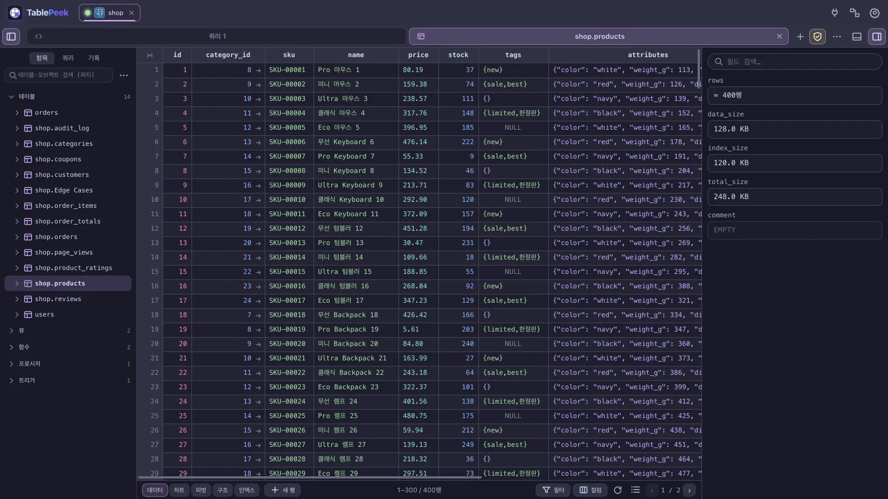
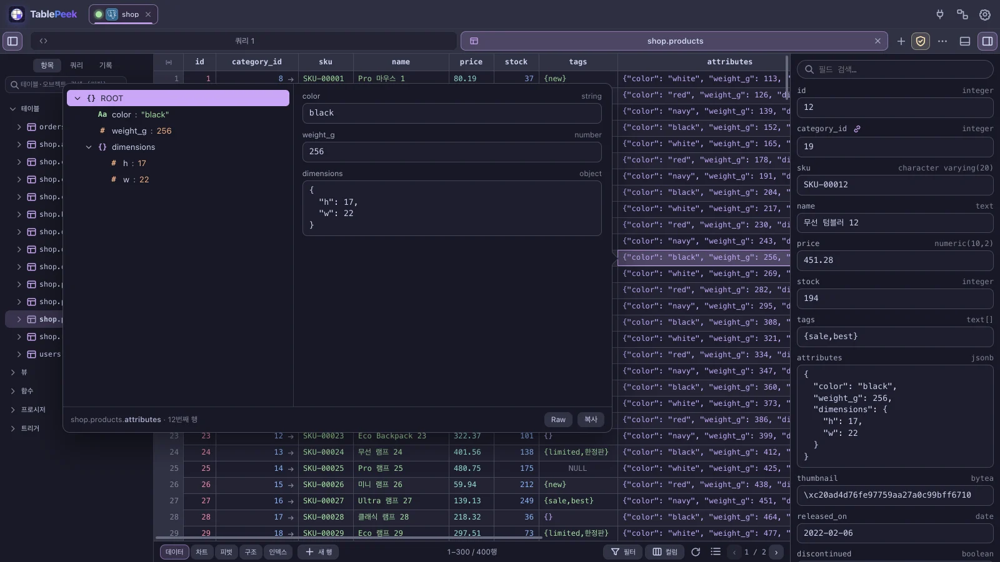
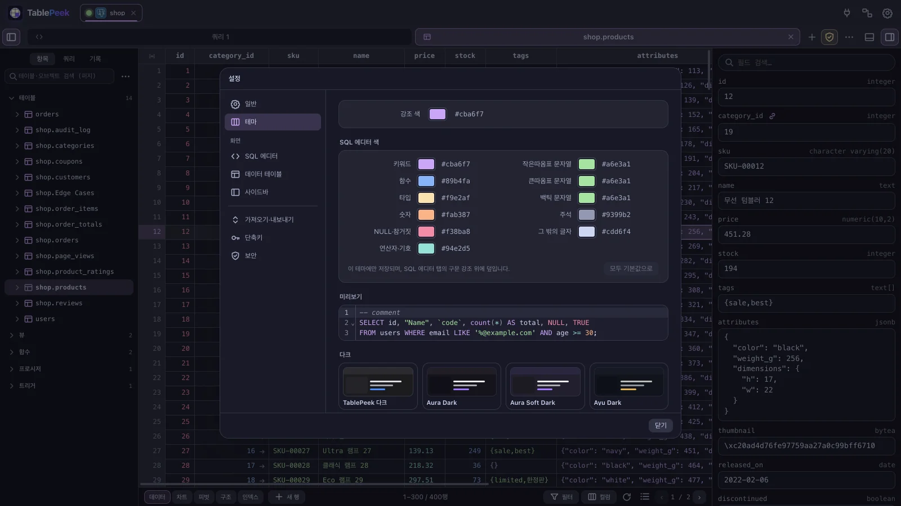
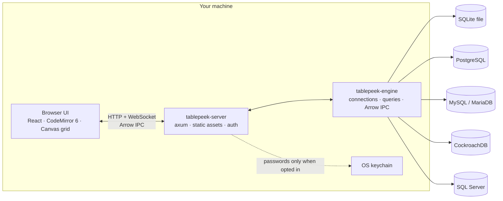

# TablePeek

**A fast, local-first database client that runs in your browser.**

TablePeek pairs a Rust query engine with a browser UI. Open SQLite files or connect to PostgreSQL, MySQL/MariaDB, CockroachDB, and SQL Server. Query, inspect, edit, and explore data without a cloud relay or a heavyweight desktop shell.



## At a glance

| | |
|---|---|
| **Databases** | SQLite, PostgreSQL, MySQL/MariaDB, CockroachDB, SQL Server |
| **Runtime** | Local Rust engine + browser UI |
| **Transport** | HTTP + WebSocket, Arrow IPC streaming |
| **Editing** | Primary-key cell edits, row insert/delete, transactions |
| **Security** | Loopback-only, per-run token, OS keychain, TLS/mTLS, SSH tunnels |
| **Themes** | 9 built-in themes + Base16/VS Code theme import |

## Why TablePeek

- **Local by design.** The engine binds to `127.0.0.1` and stops there. There is no hosted backend and no cloud relay; direct connections and SSH tunnels run from your machine to the database.
- **Built for real result sets.** Results stream as Arrow IPC and render on a canvas grid that only paints visible cells. Queries are cancellable, and large tables are fetched in windows instead of loaded all at once.
- **Five engines, one workflow.** Use the same grid, editor, schema browser, and Quick Look across SQLite, PostgreSQL, MySQL/MariaDB, CockroachDB, and SQL Server.
- **Edits with guardrails.** Cell updates target a single row through its primary key. Row inserts and deletes are explicit, and transaction state is tracked per session.
- **Inspect, don't guess.** Open any cell in Quick Look for a full value editor, a structured JSON tree, and encoding/HEX views.
- **AI access without write access.** The built-in MCP server exposes schema discovery and read-only queries over stdio.

## Quick start

TablePeek is built from source for now, so you need two toolchains: **Rust** (`cargo`, for the server) and **Node.js 20+** (`npm`, for the web bundle). SQLite is bundled and TLS uses rustls, so there is no OpenSSL or database client library to install. macOS and Windows are the primary targets; Linux uses the same stack.

### 1. Install the toolchains

**macOS**

```sh
xcode-select --install                                          # C compiler and linker (skip if already installed)
curl --proto '=https' --tlsv1.2 -sSf https://sh.rustup.rs | sh  # Rust: cargo, rustc
brew install node                                               # Node.js 20+ (or the installer from nodejs.org)
```

**Windows**

1. Download and run `rustup-init.exe` from [rustup.rs](https://rustup.rs). When it offers to install the Visual Studio C++ Build Tools, accept: Rust uses that linker on Windows.
2. Install Node.js 20+ (LTS) from [nodejs.org](https://nodejs.org).

**Linux (Debian/Ubuntu)**

```sh
sudo apt install build-essential pkg-config libdbus-1-dev       # compiler; D-Bus headers for the password keyring
curl --proto '=https' --tlsv1.2 -sSf https://sh.rustup.rs | sh
```

Install Node.js 20+ from [nodejs.org](https://nodejs.org) or a version manager such as nvm; distribution packages are often older.

Then **open a new terminal** and check both tools:

```sh
cargo --version
node --version    # v20 or later
```

> `cargo: command not found` right after installing Rust means the terminal predates the installer's PATH change. Open a new terminal, or on macOS/Linux run `source "$HOME/.cargo/env"`.

### 2. Build and run

macOS / Linux:

```sh
git clone https://github.com/Extransload/TablePeek.git
cd TablePeek
make install
make run
```

Windows has no `make`, so run the same steps in PowerShell:

```powershell
git clone https://github.com/Extransload/TablePeek.git
cd TablePeek
cd web; npm install; npm run build; cd ..
cargo run -p tablepeek -- serve --port 7870
```

The first build compiles every Rust dependency and takes a few minutes; later starts take seconds.

`make run` builds the web bundle and Rust binary, starts the server, and opens the browser on the connection home, where you add your first connection. The console prints a tokenized loopback URL; keep that URL private.

To look around with sample data first, start with an in-memory demo database:

```sh
make run DEMO=1
# Windows: cargo run -p tablepeek -- serve --demo
```

Open an existing SQLite file:

```sh
make run DB=/absolute/path/to/app.sqlite
# Windows: cargo run -p tablepeek -- serve --db C:\path\to\app.sqlite
```

Useful options:

```sh
make run PORT=7871                 # default port is 7870
make run DEMO=1 DEMO_ROWS=500000   # demo database with more rows, up to 2,000,000
make run NO_OPEN=1                 # do not open a browser automatically
make help                          # full command list
```

## Database connections

Create connections from the in-app connection screen. Profiles are saved in `~/.tablepeek/store.json` without passwords; a saved password is stored in the operating system keychain (the default for new connections; pick "ask every time" to type it on each connect).

| Driver | Connect to | Notes |
|---|---|---|
| **SQLite** | Local file or in-memory demo | File picker, `--db`, or the built-in demo |
| **PostgreSQL** | PostgreSQL servers | `ssl_mode=disable/prefer/require`, CA certificates, mTLS client certificates |
| **MySQL** | MySQL and MariaDB | TLS `prefer`/`require`, CA certificates, mTLS client certificates |
| **CockroachDB** | CockroachDB clusters | PostgreSQL wire protocol; internal tables are excluded from schema browsing |
| **SQL Server** | Microsoft SQL Server | TDS driver with an `encrypt` option |

Connection features:

- **SSH tunnels.** Enable a tunnel and provide the SSH host, port, user, and key or password. Database host and port are resolved from the SSH server's point of view, for example `127.0.0.1:5432`.
- **Preflight checks.** The connection dialog verifies local certificate and SSH key paths before connecting.
- **Connection state.** Color-coded connection tabs, environment badges (`LOCAL`, `DEV`, `STAGE`, `PROD`), and live status indicators keep multiple environments easy to distinguish.

## A closer look

### The data grid

Filter with `AND`/`OR`, sort by one or more columns, paginate, and jump across foreign keys. Insert, duplicate, and delete rows; edit cells through primary-key-targeted updates; and group changes in explicit transactions.

Type colors distinguish strings, integers, floats, bigints, booleans, JSON, lists, dates, and `NULL`. Colors are derived from the active theme, and custom `typeInks` overrides are supported.

Export the current result as CSV, JSON, XML, or SQL `INSERT` statements. Import CSV or JSON into a table, hide or reorder columns, and copy values without leaving the keyboard.

### Quick Look

Middle-click a cell, or press `Mod+Enter`, to open Quick Look. The drawer provides:

- A full-width value editor with primary-key saves and `NULL` support
- A collapsible JSON tree with path copying
- An encoding/HEX inspector
- Copy actions for values, JSON paths, decoded text, and raw hex



`Alt`-click opens the cell menu. `Space` opens row details with relationship tabs, including foreign-key navigation.

### Query workbench

- CodeMirror 6 editor with SQL completion and IME-safe input
- Query tabs, snippets, execution history, and favorites
- Command palette (`Mod+P`), new tab (`Mod+T`), close tab (`Mod+W`)
- Safe mode that asks for confirmation before `UPDATE`/`DELETE` without a `WHERE` clause
- Visual `EXPLAIN` / `EXPLAIN ANALYZE` plans with cost, estimated/actual rows, and raw JSON
- Query cancellation and live timing

### Schema and server tools

Browse tables, views, functions, triggers, and sequences from the sidebar. Open Structure and DDL tabs, create tables, create or drop databases, and inspect generated SQL before applying it. MySQL tables expose collation, `ROW_FORMAT`, and comment options. Laravel `Schema::create` output can be copied directly from the table menu.

The server info tab shows engine version, database size, uptime, and sessions, with session termination where the engine supports it.

### Settings and themes

Nine built-in themes are included: TablePeek Dark, TablePeek Light, Catppuccin Latte, Catppuccin Frappé, Catppuccin Macchiato, Catppuccin Mocha, Nord, Dracula, and Tokyo Night. You can also import Base16, VS Code, or TablePeek theme JSON from a Git URL.



Settings cover accent color, font and size, alternating row backgrounds, type colors, auto-hiding scrollbars, CSV delimiter and encoding, SQL syntax presets, keyboard shortcuts, and activity-log retention. The interface is available in English and Korean.

## MCP for AI clients

`tablepeek mcp` starts a stdio MCP server that connects to a running TablePeek instance. It exposes read-only schema and query tools without opening another port.

```json
{
  "mcpServers": {
    "tablepeek": {
      "command": "/absolute/path/to/tablepeek",
      "args": ["mcp"],
      "env": {
        "TABLEPEEK_URL": "http://127.0.0.1:7870",
        "TABLEPEEK_TOKEN": "<TABLEPEEK_TOKEN>",
        "TABLEPEEK_CONN": "<CONNECTION_ID>"
      }
    }
  }
}
```

`TABLEPEEK_CONN` is optional; omit it to use the default connection.

| Tool | Purpose |
|---|---|
| `tablepeek_list_connections` | List active connections |
| `tablepeek_list_tables` | List tables and columns |
| `tablepeek_describe_table` | Columns, indexes, foreign keys, and DDL |
| `tablepeek_query` | Run read-only `SELECT`, `WITH`, `SHOW`, `DESCRIBE`, or `EXPLAIN` |

`tablepeek_query` rejects multi-statement input and write statements. That guard is an accident-prevention filter, not a privilege boundary. Use a read-only database role if you need hard enforcement. Tokens and connection IDs change when the server restarts, so update the MCP configuration after a restart.

See [docs/MCP.md](docs/MCP.md) for setup details and security notes.

## Architecture



The server owns the loopback listener, authentication, WebSocket streaming, SSH tunnels, connection profiles, and embedded web assets. The engine owns drivers, sessions, query execution, cancellation, Arrow serialization, and row operations.

Read [docs/ARCHITECTURE.md](docs/ARCHITECTURE.md) for the full design and protocol notes.

## Security model

- **Loopback only.** The HTTP/WebSocket listener binds to `127.0.0.1`; there is no remote listener.
- **Per-run access token.** Each server start generates a token. The browser receives it in the launch URL and sends it with API requests as `x-tablepeek-token`.
- **Host header validation.** Requests with unexpected `Host` headers are rejected to mitigate DNS rebinding.
- **Credentials stay local.** `store.json` contains connection metadata and key paths, not passwords. Saved passwords live in the OS keychain (the default for new connections; choose "ask every time" per connection to keep none).
- **Encrypted exports.** Exported connections (`.tablepeek`) are sealed with a file password (Argon2id + AES-256-GCM). Saved passwords go in only when you tick "include saved passwords".
- **Encrypted connections.** PostgreSQL and CockroachDB support `disable`/`prefer`/`require` SSL modes plus CA and client certificates. MySQL supports TLS with CA and client certificates. SQL Server exposes an encryption toggle.
- **SSH without a relay.** Remote databases are reached through a local SSH tunnel, not a hosted proxy.
- **MCP is read-only by policy.** The query filter blocks writes, but a token holder can still read any database the active connection can see. Enforce stricter limits with database roles.

## Build and test

```sh
make build        # web bundle + Rust binary
make test         # Rust tests + TypeScript checks
make check        # formatting, Rust checks, TypeScript checks
make test-docker  # integration tests against Docker-backed databases
```

The Docker suite expects the test containers described in the repository. Individual tools are available too:

```sh
cd web && npm run typecheck
cd web && npm run build
cargo check --workspace
cargo test
```

## Project layout

| Path | Contents |
|---|---|
| `crates/tablepeek` | CLI entry point and `serve` / `mcp` subcommands |
| `crates/tablepeek-server` | axum server, auth, static assets, WebSocket, SSH tunnels |
| `crates/tablepeek-engine` | Drivers, sessions, query execution, Arrow IPC, row operations |
| `crates/tablepeek-types` | Shared request, result, and connection types |
| `web` | React UI, CodeMirror editor, canvas grid, themes, i18n |
| `docs` | Architecture, MCP, remaining scope, and manual checklists |

## Status

TablePeek is pre-release. The feature set is implemented and exercised across the five drivers, but signed installers and package-manager distribution are still ahead. Source builds are the supported path today.

See [docs/REMAINING-SCOPE.md](docs/REMAINING-SCOPE.md) for the current scope boundaries and [docs/ARCHITECTURE.md](docs/ARCHITECTURE.md) for design decisions and protocol details.
