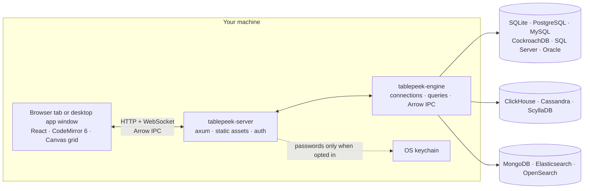

# Developing TablePeek

- [Architecture](#architecture)
- [Build from source](#build-from-source)
- [Build and test](#build-and-test)
- [Test databases](#test-databases)
- [Project layout](#project-layout)

Maintainers cut releases as described in [RELEASING.md](RELEASING.md). TablePeek is in its 0.x series: new features raise the minor version and fixes the patch version, and [CHANGELOG.md](../CHANGELOG.md) lists what each release changed.

## Architecture



The server owns the loopback listener, authentication, WebSocket streaming, SSH tunnels, connection profiles, UI state, and embedded web assets. The engine owns drivers, sessions, query execution, cancellation, Arrow serialization, and row operations. `tablepeek serve` runs the server and opens a browser tab. The desktop app (`crates/tablepeek-desktop`, Tauri 2) runs the same server inside the app and shows the page in a native window.

Read [ARCHITECTURE.md](ARCHITECTURE.md) for the full design and protocol notes.

## Build from source

Building needs two toolchains: **Rust** (`cargo`, for the server) and **Node.js 20+** (`npm`, for the web bundle).

### 1. Install the toolchains

**macOS**

```sh
xcode-select --install                                          # C compiler and linker (skip if already installed)
curl --proto '=https' --tlsv1.2 -sSf https://sh.rustup.rs | sh  # Rust: cargo, rustc
brew install node                                               # Node.js 20+ (or the installer from nodejs.org)
```

**Windows**

1. Download and run `rustup-init.exe` from [rustup.rs](https://rustup.rs). When it offers to install the Visual Studio C++ Build Tools, accept: Rust uses that linker on Windows.
2. Install Node.js 20+ (LTS) from [nodejs.org](https://nodejs.org).

**Linux (Debian/Ubuntu)**

```sh
sudo apt install build-essential pkg-config libdbus-1-dev       # compiler; D-Bus headers for the password keyring
curl --proto '=https' --tlsv1.2 -sSf https://sh.rustup.rs | sh
```

Install Node.js 20+ from [nodejs.org](https://nodejs.org) or a version manager such as nvm; distribution packages are often older.

Then **open a new terminal** and check both tools:

```sh
cargo --version
node --version    # v20 or later
```

> `cargo: command not found` right after installing Rust means the terminal predates the installer's PATH change. Open a new terminal, or on macOS/Linux run `source "$HOME/.cargo/env"`.

### 2. Build and run

macOS / Linux:

```sh
git clone https://github.com/Extransload/TablePeek.git
cd TablePeek
make install
make run
```

Windows has no `make`, so run the same steps in PowerShell:

```powershell
git clone https://github.com/Extransload/TablePeek.git
cd TablePeek
cd web; npm install; npm run build; cd ..
cargo run -p tablepeek -- serve --port 7870
```

The first build compiles every Rust dependency and takes a few minutes; later starts take seconds.

`make run` builds the web bundle and Rust binary, starts the server, and opens the browser on the connection home, where you add your first connection. The console prints a tokenized loopback URL; keep that URL private.

To look around with sample data first, start with an in-memory demo database:

```sh
make run DEMO=1
# Windows: cargo run -p tablepeek -- serve --demo
```

Open an existing SQLite file:

```sh
make run DB=/absolute/path/to/app.sqlite
# Windows: cargo run -p tablepeek -- serve --db C:\path\to\app.sqlite
```

Useful options:

```sh
make run PORT=7871                 # default port is 7870
make run DEMO=1 DEMO_ROWS=500000   # demo database with more rows, up to 2,000,000
make run NO_OPEN=1                 # do not open a browser automatically
make desktop                       # the desktop app from source (macOS, Windows)
make desktop-bundle                # bundle the desktop app (.app/.dmg or NSIS installer)
make help                          # full command list
```

## Build and test

```sh
make build        # web bundle + Rust binary
make test         # Rust tests + TypeScript checks
make check        # formatting, Rust checks, TypeScript checks
make test-docker  # integration tests against Docker-backed databases
make build-kerberos-linux  # Linux binary with Kerberos, built in Docker
```

Kerberos (GSSAPI) logins to MongoDB are built in on macOS. On Linux they are a build option, since they link the system's MIT Kerberos library. Besides the packages in [Install the toolchains](#1-install-the-toolchains), install its headers and libclang (`sudo apt install libkrb5-dev libclang-dev`) and build with `cargo build --release -p tablepeek --features kerberos`. The binary then needs `libgssapi-krb5-2` at run time, and `kinit` (`krb5-user`) gets the tickets it logs in with. `make build-kerberos-linux` does that build in Docker, in the official Rust image plus those packages, and writes `target/linux/release/tablepeek` for the Docker machine's architecture; downloaded crates stay in the `tablepeek-cargo-registry` volume. Set `CARGO_BUILD_JOBS=4` when the Docker machine runs short of memory.

Individual tools are available too:

```sh
cd web && npm run typecheck
cd web && npm run build
cargo check --workspace
cargo test
```

## Test databases

`testdb/compose.yml` runs throwaway PostgreSQL, MySQL, CockroachDB, SQL Server, and MongoDB servers in Docker, seeded with the rows the engine's live tests read. Start every engine, or only the ones `ENGINE` names:

```sh
make test-db ENGINE=postgres          # or ENGINE="mysql mssql"; all five when omitted
make test-live ENGINE=postgres        # the engine's live tests against them
make test-db-down ENGINE=postgres     # stop them and throw the data away
```

`make test-db` prints the host, port, and account for each one, so you can also add them as connections in TablePeek and try the app on a real server. Ports are bound to `127.0.0.1` only, and the accounts are test-only: never reuse them on a real server. MySQL listens on 3329, leaving 3307 available for production proxies; set `TABLEPEEK_TEST_MYSQL_PORT` (for `make test-db` and `make test-live` alike) to override it. SQL Server has no arm64 image, so on Apple Silicon it runs under emulation and takes a minute to start.

A few servers for particular tests sit in compose profiles, so `make test-db` leaves them out; name them in `ENGINE` to start them (and `make test-live ENGINE=…` to run their tests):

| `ENGINE` | What | Address |
|---|---|---|
| `mongodb-x509` | TLS required, X.509 logins; `make test-db` writes a throwaway CA, server and client certificate to `testdb/x509` | `127.0.0.1:27020`, CA `testdb/x509/ca.pem`, client `testdb/x509/client.pem` |
| `mongodb-ldap` | MongoDB Enterprise checking PLAIN logins against OpenLDAP | `127.0.0.1:27021`, LDAP user `ann` / `ann_ldap_pw` |
| `mongodb-kerberos` | MongoDB Enterprise taking GSSAPI logins, with an MIT KDC for the realm `TABLEPEEK.TEST` | `127.0.0.1:27022`, principal `ann@TABLEPEEK.TEST` / `ann_krb_pw`, service host `kerberos.tablepeek.test`; KDC `127.0.0.1:1088`, client config `testdb/kerberos/krb5.conf` |
| `mongodb-oidc` | MongoDB Enterprise taking MONGODB-OIDC logins from a local identity provider (any user name on its login page) | `127.0.0.1:27023`; provider `https://127.0.0.1:8180/tablepeek`, whose certificate comes from the `testdb/x509` CA |
| `mongodb-aws` | MongoDB Enterprise taking MONGODB-AWS logins, checked by a local STS stand-in | `127.0.0.1:27024`, key `AKIATABLEPEEKTEST` / `tablepeek_aws_secret`, session token `tablepeek_session_token` |
| `mongodb-rs` | a three-member replica set whose members (`rs1.tablepeek.test`…) only an SSH server reaches, and a DNS server with `mongodb+srv://rs.tablepeek.test` | SSH `127.0.0.1:2223`, user `tablepeek`, key `testdb/ssh/id_ed25519`; DNS `127.0.0.1:1053` |
| `mongodb-atlas` | Atlas Local, for search indexes | `127.0.0.1:27019`, no authentication |
| `mongodb-sharded` | a config server, one shard and mongos | `127.0.0.1:27040`, no authentication |
| `elasticsearch` | Elasticsearch 8 with security on and HTTP TLS off, seeded with a shop (indices `shop-*`, aliases `shop` and `orders`, data stream `logs-shop-default`); about 1 GB, so start it alone | `127.0.0.1:9201`, `elastic` / `tablepeek_test_pw` |
| `opensearch` | OpenSearch 2 with its security plugin's demo setup (HTTPS, self-signed certificate) and the same shop; `make test-db` copies the certificate to `testdb/opensearch/node.pem` | `127.0.0.1:9202`, `admin` / `TablePeek_test_pw1` |
| `clickhouse` | ClickHouse 25.8 over HTTP and HTTPS (certificate from the `testdb/x509` CA for `localhost` and `clickhouse.tablepeek.test`), seeded with `tablepeek_test` and a `shop` database (MergeTree family, materialized views, a dictionary), and the SSH server in front of it for tunnel tests; capped at 1 GB | HTTP `127.0.0.1:18123`, HTTPS `127.0.0.1:18443`, `tablepeek` / `tablepeek_test_pw`; through SSH `127.0.0.1:2223` (user `tablepeek`, key `testdb/ssh/id_ed25519`) as `clickhouse.tablepeek.test:8123`/`8443` |
| `clickhouse-cluster` | Two ClickHouse 25.8 servers as cluster `tp_cluster` (one shard, two replicas, ClickHouse Keeper inside the first), for `ON CLUSTER`; capped at 768 MB each, nothing seeded | HTTP `127.0.0.1:18124` and `127.0.0.1:18125`, `tablepeek` / `tablepeek_test_pw` |
| `cassandra` | Cassandra 5 with logins, Java UDFs and materialized views on, seeded with the keyspaces `tablepeek_test` and `shop` (partition and clustering keys, a counter table, collections, a UDT, a materialized view, SAI); heap 512 MB, capped at 1.2 GB, so start it alone | `127.0.0.1:9043`, `tablepeek` / `tablepeek_test_pw` (superuser `cassandra` / `cassandra`) |
| `scylladb` | ScyllaDB on one shard with 512 MB, logins and Lua UDFs on, the same keyspaces (seeded over the maintenance socket, since ScyllaDB makes no default superuser); capped at 1 GB, start it alone | `127.0.0.1:9044`, `tablepeek` / `tablepeek_test_pw` (superuser) |
| `scylladb-cluster` | Two ScyllaDB nodes (256 MB each, capped at 600 MB each) and the SSH server, seeded like `scylladb`, for tunnels that reach every node of a cluster; start it alone | only through SSH `127.0.0.1:2223`, user `tablepeek`, key `testdb/ssh/id_ed25519`; host `scylla-a:9042`, `tablepeek` / `tablepeek_test_pw` |
| `oracle` | Oracle Database 23ai Free (`gvenzl/oracle-free:23-slim-faststart`, arm64 native) and the SSH server, seeded with the test schema `TABLEPEEK` (every type, one object of each kind) and the sample schema `SHOP`, with a TCPS listener (wallet built from `testdb/x509` by `testdb/oracle-wallet.sh`, which runs Oracle's PKI library on Java); capped at 2.5 GB, start it alone | `127.0.0.1:15210`, service `FREEPDB1`, `tablepeek` / `tablepeek_test_pw` (no-rights account `shop` / `tablepeek_test_pw`; SYS `Oracle_test_pw1`); TCPS `127.0.0.1:15211` (CA `testdb/x509/ca.pem`); through SSH `127.0.0.1:2223` as `oracle:1521` / `oracle:2484` |

Enterprise Server is used here for evaluation only.

- **Kerberos in the app.** Start TablePeek with `KRB5_CONFIG=$PWD/testdb/kerberos/krb5.conf` and `KRB5CCNAME=FILE:/tmp/tablepeek-krb5cc` after `kinit ann@TABLEPEEK.TEST` with the same two (macOS: `kinit --password-file=STDIN`), so your own Kerberos settings and tickets stay untouched; the live test does this itself. On Linux, `make test-live ENGINE=mongodb-kerberos` turns the kerberos feature on and needs MIT's `kinit`. From macOS, `make test-live-linux ENGINE=mongodb-kerberos` runs the same tests in the Linux build container, which shares the host's network to reach the test servers (Docker Desktop: turn on host networking in Settings > Resources > Network).
- **OIDC.** Start TablePeek with `SSL_CERT_FILE=$PWD/testdb/x509/ca.pem` so it trusts the provider (your browser will warn about the same certificate once).
- **Cloud-only paths.** AWS's real STS, instance roles, and the Azure and GCP metadata endpoints exist only in the cloud; those paths are covered by unit tests of what would be sent.

Beside the test rows, each server holds a sample shop to explore: the `shop` schema (on MySQL, the `shop` database). It has customers, products, orders, order items, reviews and more, about 28,000 rows in all. They are tied together by foreign keys: a self-reference, composite and text keys, CASCADE and SET NULL. There are also enums and JSON (on SQL Server, CHECK lists and JSON text), arrays where the engine has them, binary columns, a table without a primary key, and a table of awkward names and values (Korean, emoji, quotes, multi-line text, extreme numbers and dates). Two views, a function, a procedure and an audit trigger complete it. The `testdb/*-shop.sql` scripts build it. They never rebuild what is already there, and PostgreSQL and MySQL run theirs only when the container is first created. So after changing a script, or the sample's tables, run `make test-db-down` to start fresh.

## Project layout

| Path | Contents |
|---|---|
| `crates/tablepeek` | CLI entry point and `serve` / `mcp` subcommands |
| `crates/tablepeek-desktop` | Desktop app for macOS and Windows (Tauri 2) around the same server |
| `crates/tablepeek-server` | axum server, auth, static assets, WebSocket, SSH tunnels, UI state |
| `crates/tablepeek-engine` | Drivers, sessions, query execution, Arrow IPC, row operations |
| `crates/tablepeek-types` | Shared request, result, and connection types |
| `web` | React UI, CodeMirror editor, canvas grid, themes, i18n |
| `testdb` | Docker Compose test databases and their seed data |
| `scripts` | Version bumps, release notes, release archives, updater manifest, Homebrew cask (`version.mjs`, `package.sh`, `latest-json.mjs`, `homebrew-cask.mjs`) |
| `.github/workflows` | CI on `main` and the release build for `v*` tags |
| `docs` | Install and user guides, architecture, MCP, engines, releasing, and manual checklists |
