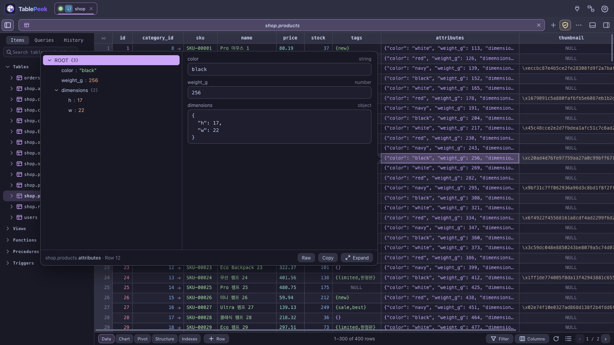
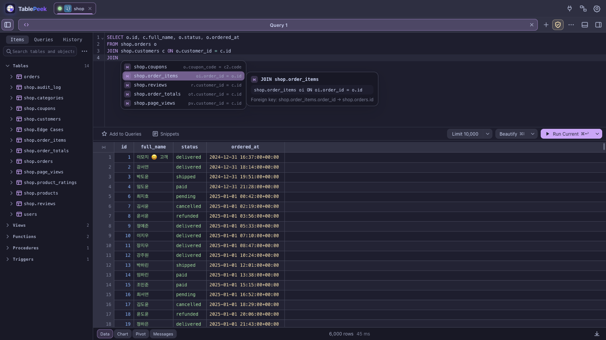
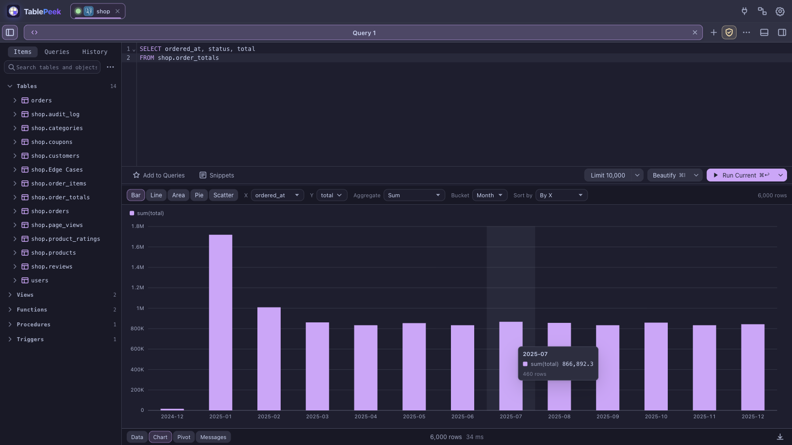
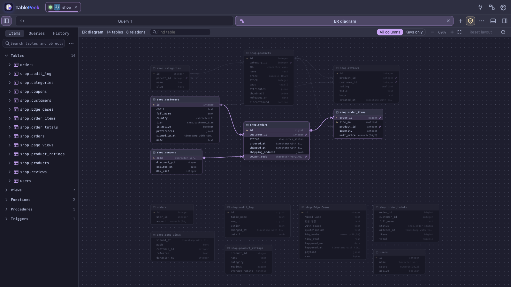
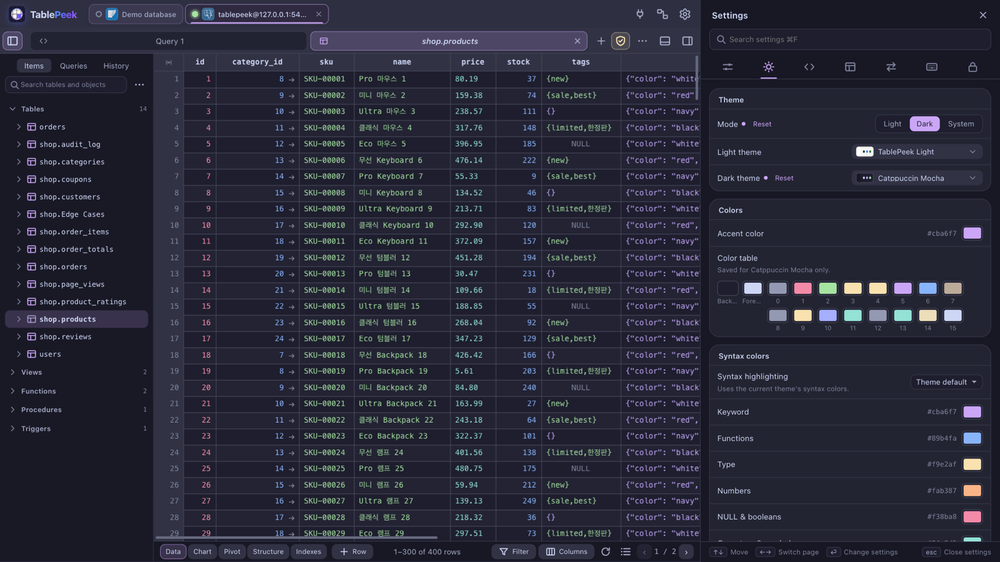

# TablePeek user guide

- [Databases](#databases)
- [The data grid](#the-data-grid)
- [Import, export, dump, and restore](#import-export-dump-and-restore)
- [Quick Look](#quick-look)
- [Query workbench](#query-workbench)
- [Schema and server tools](#schema-and-server-tools)
- [MongoDB workbench](#mongodb-workbench)
- [Connections](#connections)
- [Settings and themes](#settings-and-themes)
- [MCP for AI clients](#mcp-for-ai-clients)
- [Security](#security)

## Databases

Create connections from the in-app connection screen. Profiles are saved in `~/.tablepeek/store.json` without passwords. A saved password is stored in the operating system keychain (the default for new connections; pick "ask every time" to type it on each connect).

| Driver | Connect to | Notes |
|---|---|---|
| **SQLite** | Local file or in-memory demo | Saved connection profiles with a database path (native file dialog), quick open from the file picker, `--db`, or the built-in demo |
| **PostgreSQL** | PostgreSQL servers | `ssl_mode=disable/prefer/require`, CA certificates, mTLS client certificates |
| **MySQL** | MySQL and MariaDB | TLS `prefer`/`require`, CA certificates, mTLS client certificates |
| **CockroachDB** | CockroachDB clusters | PostgreSQL wire protocol; internal tables are excluded from schema browsing |
| **SQL Server** | Microsoft SQL Server | TDS driver with an `encrypt` option |
| **Oracle** | Oracle Database 12c and later (tested on 23ai Free) | Oracle's pure-Rust thin driver: no Instant Client. Service name, SID, Easy Connect, a `(DESCRIPTION=…)` or a tnsnames.ora alias; TCPS with a wallet (`ewallet.pem`); SYSDBA/SYSOPER; SSH/HTTP tunnels for host/port and for connect strings (each address of the descriptor through the tunnel). Schemas, synonyms, packages, materialized views and their DDL (DBMS_METADATA, kept until a structure change), PL/SQL blocks ended by `/`, DBMS_OUTPUT, EXPLAIN PLAN with DBMS_XPLAN, MERGE upserts on import, V$SESSION sessions ([details](engines/oracle.md)) |
| **MongoDB** | MongoDB servers, replica sets and Atlas | `mongodb://` or `mongodb+srv://` connection string or host fields; SCRAM, X.509, AWS IAM, LDAP, Kerberos, or OIDC (browser login or cloud identity); TLS with CA and client certificates; SSH/HTTP tunnels for single hosts, several hosts, and `mongodb+srv://` ([details](MONGODB.md)) |
| **Elasticsearch** | Elasticsearch 7–9 clusters and Elastic Cloud | URL, host fields, or Cloud ID; user and password, API key, or bearer token; TLS with a CA, a certificate fingerprint, client certificates, or no verification; SSH/HTTP tunnels. Query DSL, SQL, and a Dev Tools console ([details](engines/elasticsearch.md)) |
| **OpenSearch** | OpenSearch 1–3 clusters | The same driver and options (no Cloud ID); SQL through the SQL plugin |
| **ClickHouse** | ClickHouse servers and ClickHouse Cloud | HTTP interface (8123) or HTTPS (8443) with a CA file or no verification; SSH/HTTP tunnels. MergeTree tables edited by their sorting key, rows sharing a key told apart by `_part`/`_part_offset` (lightweight UPDATE where the table allows, else mutations), `ON CLUSTER` for structure changes, EXPLAIN plan view, native CSV/JSON export and CSV import ([details](engines/clickhouse.md)) |
| **Cassandra** | Apache Cassandra 3.11–5 clusters | CQL native protocol (9042); user and password, TLS with CA and client certificates; consistency level per connection (tab bar) or per statement (`CONSISTENCY`); SSH/HTTP tunnels to one node. Pages by the server's paging state, rows edited by their full primary key with IF EXISTS checks, tracing as the plan view ([details](engines/cassandra.md)) |
| **ScyllaDB** | ScyllaDB clusters and ScyllaDB Cloud | The same driver and options; server info names the product it reached |

Connection features:

- **SSH tunnels.** Enable a tunnel and provide the SSH host, port, user, and key or password. Database host and port are resolved from the SSH server's point of view, for example `127.0.0.1:5432`.
- **Preflight checks.** The connection dialog verifies local certificate and SSH key paths before connecting.
- **Connection state.** Color-coded connection tabs, environment badges (`LOCAL`, `DEV`, `STAGE`, `PROD`), and live status indicators keep multiple environments easy to tell apart. Waiting shows as a gauge: a connecting connection's row or tab fills with its color, and a query or table tab fills while its rows are on their way.

## The data grid

Filter with a bar of conditions: operators such as contains, starts with, in list, and between, or a raw `WHERE` fragment. Apply a condition on its own or every checked condition together with `AND`/`OR`. Sort by one or more columns, paginate, and jump across foreign keys. Column widths survive sorting, paging, and filtering. A width you drag or double-click a column to is remembered per table: it comes back when the table is opened again, even after a restart. The grid's corner button fits every column to its contents again and forgets them.

Insert, duplicate, and delete rows; edit cells through primary-key-targeted updates; set a cell to `DEFAULT` or the current time and read back what the server stored; paste into a selection; and group changes in explicit transactions. The cell menu follows the selection: copy as CSV, JSON, SQL, or Markdown, or as a staged `INSERT`/`UPDATE`.

Type colors distinguish strings, integers, floats, bigints, booleans, JSON, lists, dates, binary, and `NULL`. Binary values show as hex and can be written back as bytes. PostgreSQL values print as PostgreSQL prints them. Colors are derived from the active theme, and custom `typeInks` overrides are supported.

## Import, export, dump, and restore

Export the current result as CSV, JSON, XML, or SQL `INSERT` statements. Import a CSV or JSON file into a new or existing table with column matching, type inference, and exact big numbers. Dump selected tables to a SQL file in foreign-key order, with or without data, and restore a dump statement by statement.

Every transfer runs as a background job. A jobs panel shows progress, a failed import or restore reports the statement it stopped at, and a stop button interrupts the statement in flight. A job holds its connection from its first statement, so the page's own queries and a running import never cancel each other. Imports roll back on failure where the engine allows it (MySQL runs `CREATE TABLE` outside the transaction and drops the table instead).

## Quick Look

Middle-click a cell, or press `Mod+Enter`, to open Quick Look. The drawer provides:

- A full-width value editor with primary-key saves and `NULL` support
- A collapsible JSON tree with path copying
- An encoding/HEX inspector
- For a foreign key, the referenced row, and the referenced table filtered to that key
- Copy actions for values, JSON paths, decoded text, and raw hex
- **Expand** (or `Mod+Enter` again) for a JSON value: a window-filling view built for very large documents, with expand all, collapse all, and expand to a depth; search across keys and values (`Enter`/`Shift+Enter` step through matches); a breadcrumb with path and value copying; long strings shown in full; and a Raw view of the indented text. `Esc` returns to the drawer.



`Alt`-click opens the cell menu. `Space` opens row details with relationship tabs, including foreign-key navigation. The right panel keeps a field search and says when no row is selected.

## Query workbench

- CodeMirror 6 editor with IME-safe input and context-aware SQL completion: columns with their types, tables, `JOIN … ON` conditions from foreign keys (or guessed from names like `user_id`), common functions with signatures, statement templates with Tab-through fields, enum values inside strings, fuzzy matching (`usnm` → `user_name`), and an info panel beside the list. Options you pick often rank first.
- Query tabs, snippets, execution history, and favorites
- Command palette (`Mod+P`), new tab (`Mod+T`), close tab (`Mod+W`)
- Safe mode that asks for confirmation before `UPDATE`/`DELETE` without a `WHERE` clause
- Visual `EXPLAIN` / `EXPLAIN ANALYZE` plans with cost, estimated/actual rows, and raw JSON
- Query cancellation and live timing
- Chart and pivot views of any result or table: bar, line, area, pie/donut, and scatter charts with time bucketing and top-N grouping, and pivot tables with totals that copy as TSV





## Schema and server tools

Browse tables, views, functions, triggers, and sequences from the sidebar, indented under their section heads; the tree refreshes after the editor creates, drops, or alters anything. Open Structure and DDL tabs, create tables, create or drop databases, and inspect generated SQL before applying it. MySQL tables expose collation, `ROW_FORMAT`, and comment options. Laravel `Schema::create` output can be copied directly from the table menu.

The server info tab shows engine version, database size, uptime, and sessions, with session termination where the engine supports it.

The ER diagram tab draws every table with its columns and foreign keys, laid out automatically. Open it with the diagram button in the top bar (between the connections and settings buttons) or `Mod+P` → "ER diagram". Pan, zoom, drag cards (positions are remembered), search for a table, highlight a table's relations, show keys only, and double-click a table to open its data. A table's context menu in the sidebar opens the diagram centred on it.



## MongoDB workbench

A MongoDB connection opens a document workspace: databases and collections in the sidebar, a collection tab per collection, and mongosh tabs. A collection tab has seven sub-tabs:

- **Documents.** A filter bar with completion (you can leave out the outer braces), options for projection, sort, skip and limit, and recent and favourite queries. Results show as cards, as JSON blocks, or as a table; switch between them with the ☰ {} ⊞ icons or `Ctrl+1–3`. Click any value to edit it, keeping its BSON type. In the table, nested objects and arrays open as their own tables (`orders › items`), and the detail panel (`Mod+I`) is available there only. Saving puts each changed path's original value in the update filter. If the document changed elsewhere in the meantime, the current value and your change are shown side by side.
- **Aggregation.** A stack of stage cards, each with a preview of its output, an on/off toggle, and drag to reorder. There is also a text mode, saved pipelines, save as view, explain, and `$out`/`$merge` behind a confirmation.
- **Schema.** Analyses a sample of up to 1,000 documents: field presence, the mix of types, histograms, and frequent values. Clicking a value filters the documents by it.
- **Validation.** Edit a `$jsonSchema` or query rule, or draft one from the data. See how many sampled documents would pass or fail before applying it with `collMod`.
- **Indexes.** Lists each index with its size and usage (`$indexStats`), and creates or drops indexes.
- **Explain.** Runs `explain("executionStats")` and shows a stage tree, warnings, and a suggested index.
- **Changes.** Watches the collection through a change stream (a database-wide one from the sidebar), with operation filters and the document before and after.

The mongosh tab runs mongosh statements. Scripts with variables, loops, and functions run as JavaScript in a Web Worker, reading `find`/`aggregate` through server cursors. Import reads JSON, NDJSON, Extended JSON, and CSV/TSV with a type for each column. Export writes JSON, NDJSON, or CSV, streamed from the server. Databases, collections (capped, time series, clustered), and views can be created, renamed, and dropped. The performance tab charts operations, connections, network, and cache use, lists the operations running now (and can kill them), and shows time per collection and the slow-operation profiler.

The documents view also has query options (collation, hint, maxTimeMS), bulk update and delete with a before/after preview, and export of the query or pipeline as driver code (mongosh, Python, Node.js, Java, C#, Go, Rust, PHP, Ruby). The schema tab plots GeoJSON and `[lng, lat]` fields on an offline world map and turns a drawn region into a `$geoWithin` filter. The indexes tab manages Atlas Search and vector search indexes where the server has them, and GridFS buckets show in the sidebar with file listing, upload, download, and delete. Documents over 1 MB and arrays over 1,000 elements are cut short in the cards and JSON views, with "Show all".

## Connections

The connection home groups saved connections. Drag a connection to reorder it within its group or drop it at any spot in another group (onto a folded group's header to put it there), and drag groups to reorder them; the rows part to show where it will land, and `Esc` puts it back. With a connection or group header focused, `Alt+↑`/`Alt+↓` (`⌥↑`/`⌥↓`) move it one place. The order is remembered. Start a new connection from the kind of database you want, or open one from the connection bar. A SQLite connection is saved like any other, with a name, colour, tags, and the database file. Files are picked with the operating system's own open dialog, and the same file opened twice goes to the one connection already open. Connection tabs close on a single click and move focus to their neighbour. Saved connections export to a password-sealed `.tablepeek` file and import back on another machine.

## Settings and themes

Settings open as a sheet docked on the right (`Mod+,` or the gear button), with the app still visible beside it so every change shows live. The pages follow Tern's: General (language, updates, activity-log retention), Appearance (every font and color, in cards: Theme, Colors, Syntax colors with an editor preview, Value colors, Fonts, Material, Display), SQL Editor (keyword case), Data Table (maximum rows, query time limit), Import and export, Shortcuts, Security. Everything works from the keyboard: `↑`/`↓` move between settings (across cards), `←`/`→` switch pages, `Enter` or `Space` flips a switch, steps a choice or opens a menu or picker, `Backspace` resets a changed setting (marked with a dot), and `Esc` steps back (out of a field, clears the search, then closes). Drag the sheet's left edge, or press `←`/`→` on it, to resize it. Scrollbars are the app's own: thin, one size under the pointer, and optionally always in view for the grid and editor.

**Live preview.** In the theme, font, font size and syntax preset menus, the option under the pointer or highlighted with `↑`/`↓` shows in the whole app right away (a light theme even while dark is shown, and the other way round), without being saved. A click or `Enter` saves it; closing the menu any other way (`Esc`, `Tab`, a click elsewhere, closing Settings) puts the saved look back. Previews stay in the window they are made in.

**Search.** Type anywhere in the sheet, or press `Mod+F`, to search every page. Matching settings are listed under their page's name with the match highlighted, in Korean or English whatever the interface language; a page's name offers that page (`Enter` opens it). `↑`/`↓` and `Enter` work on the results directly, and `Esc` clears the search.

**Motion.** Tabs, dialogs, menus, the settings sheet, panels, the schema tree, Quick Look, counts and dragged connections animate in one style, on springs. Settings › Appearance › Display › Reduce motion makes every change instant (the home backdrop becomes a still frame), at once and in every window; nothing in TablePeek waits for an animation. Only this setting decides: the operating system's Reduce motion preference is not followed.

**Theme.** Settings › Appearance › Mode is Light, Dark or System; System follows the operating system's light or dark mode as it changes (in the desktop app the window follows it too). The light and dark themes are picked separately, each in a small searchable picker (type to filter, `↑`/`↓`, `Enter` picks, `Esc` closes) with a swatch per theme. The accent follows the theme shown unless one is picked.

**Fonts.** Like Tern's, the fonts cascade; all of them are in Settings › Appearance › Fonts. Font and Font size set the interface (sidebars, menus, dialogs). Code font is the monospaced face the SQL editor, the data table and code labels use; its size follows Font size unless set. Editor font and Table font (and their sizes) follow the code font unless set apart. Every picker lists the system's faces and every face installed on the machine, monospaced ones first. Settings saved by earlier versions move over on first start: one theme becomes the theme of its mode, and the SQL editor's, data table's and sidebar's fonts become the code font, a table font where it differed, and the interface font where the sidebar's differed.

**Material.** Settings › Appearance sets the surface material: Solid, Glass (translucent, with an opacity), or Clear (blurred, with a blur radius). Dialogs, menus, the command palette and the settings sheet turn to tinted glass. In the desktop app the window itself becomes see-through: macOS vibrancy or a blur without tint, Mica or Acrylic on Windows. The picked material alone decides; the system's Reduce transparency setting is not followed (pick Solid for opaque surfaces).

Fifty-two built-in themes are included: TablePeek Dark and Light, Dark Noir and Light Noir, plus Aura, Ayu, Catppuccin, Cobalt2, Dracula, Everforest, GitHub, Gruvbox, Horizon, Kanagawa, Material, Monokai, Night Owl, Nord, One Dark/Light, Panda, Pink Aura, Rosé Pine, Shades of Purple, Snazzy, Solarized, SynthWave '84, Tokyo Night, Tomorrow Night, and Xcode variants. The third-party themes also color the SQL editor while the syntax preset is left on "Theme default"; TablePeek Dark/Light derive editor colors from their accent and status colors. Dark Noir is the look of a Tern terminal theme (Dracula-style surfaces, a vivid 16-color table, a teal accent); Light Noir keeps its hues, darkened so every text color reads at 4.5:1 or better.

**Tern themes.** The theme pickers' Tern group holds the 102 themes of the Tern terminal (oh-my-pi's theme set: `dark`, `light`, and 100 more, MIT-licensed), converted at build time and loaded only when Settings opens or one of them is in use. "Import Tern theme…" at the end of either picker takes a Tern theme CSS (`~/Library/Application Support/Tern/themes/*.css`): its `@import`ed theme with the file's `--tv-bg`, `--tv-fg`, `--ansi0`…`--ansi15` and surface variables (`--tn-page`, `--card`, `--raise`, `--code-bg`, `--tn-pop`) over it, named after the file; other rules (tab and window styling) are skipped. It becomes the theme of its mode. Imported themes are listed under "Imported" in the picker and can be removed there (the × on the entry, or `Mod+Backspace`).

**Color table.** Settings › Appearance shows the color table of the theme shown: background, foreground, and the 16 terminal colors (for a theme not made from one, read from its own colors). The syntax and value colors map to its slots (green strings, yellow numbers, magenta keywords and booleans, cyan functions and dates, blue types and JSON, bright black comments and `NULL`, and so on), so picking a swatch recolors every part mapped to that slot; colors are adjusted where needed to stay readable on the background. Picks are saved per theme. In the settings sheet the table is one row: `Enter` goes into it, the arrow keys move between swatches, `Enter` opens the color picker, and `Backspace` puts a swatch back to the theme's color (on the row, all of them).



Settings also cover alternating row backgrounds, type colors, the maximum rows and query time limit, CSV delimiter and encoding, SQL syntax presets, keyboard shortcuts, and activity-log retention. Both the SQL editor's syntax colors (Appearance › Syntax colors) and the data table's colors for each kind of value (Appearance › Value colors: string, integer, decimal, big integer, boolean, date, time, JSON, array, enum, UUID, binary, NULL) can be picked per theme. The interface is available in English and Korean.

Settings, workspaces, and other UI state are kept in `~/.tablepeek/ui-state.json`, so they survive restarts and are shared by the desktop app and `tablepeek serve`.

## MCP for AI clients

`tablepeek mcp` starts a stdio MCP server that connects to a running TablePeek instance. It exposes read-only schema and query tools without opening another port. Point it at a `tablepeek serve` started with a fixed port; the desktop app's port and token are not shown ([why](INSTALL.md#mcp-and-the-desktop-app)).

```json
{
  "mcpServers": {
    "tablepeek": {
      "command": "/absolute/path/to/tablepeek",
      "args": ["mcp"],
      "env": {
        "TABLEPEEK_URL": "http://127.0.0.1:7870",
        "TABLEPEEK_TOKEN": "<TABLEPEEK_TOKEN>",
        "TABLEPEEK_CONN": "<CONNECTION_ID>"
      }
    }
  }
}
```

`TABLEPEEK_CONN` is optional; omit it to use the default connection.

| Tool | Purpose |
|---|---|
| `tablepeek_list_connections` | List active connections |
| `tablepeek_list_tables` | List tables and columns |
| `tablepeek_describe_table` | Columns, indexes, foreign keys, and DDL |
| `tablepeek_query` | Run read-only `SELECT`, `WITH`, `SHOW`, `DESCRIBE`, or `EXPLAIN` |
| `mongo_list_collections` | MongoDB: databases, collections, and views |
| `mongo_find` | MongoDB: `find` with a filter, projection, and sort (at most 100 documents) |
| `mongo_aggregate` | MongoDB: an aggregation pipeline without `$out`/`$merge` (at most 100 documents) |
| `mongo_schema` | MongoDB: field paths, presence, and types from a sample of up to 200 documents |
| `mongo_indexes` | MongoDB: a collection's indexes |
| `search_list_indices` | Elasticsearch/OpenSearch: indices with health, document counts, sizes, aliases, and data streams |
| `search_mapping` | Elasticsearch/OpenSearch: an index's mapping |
| `search_query` | Elasticsearch/OpenSearch: a Query DSL search with sort, `_source`, and aggregations (at most 100 hits) |
| `search_sql` | Elasticsearch/OpenSearch: a read-only SQL query |

The tool list follows the engine of the connection the MCP server is pointed at.

`tablepeek_query` rejects multi-statement input and write statements. That guard is an accident-prevention filter, not a privilege boundary; use a read-only database role if you need hard enforcement. Tokens and connection IDs change when the server restarts, so update the MCP configuration after a restart.

See [MCP.md](MCP.md) for setup details and security notes.

## Security

- **Loopback only.** The HTTP/WebSocket listener binds to `127.0.0.1`; there is no remote listener.
- **Per-run access token.** Each server start generates a token. The browser receives it in the launch URL and sends it with API requests as `x-tablepeek-token`.
- **Host header validation.** Requests with unexpected `Host` headers are rejected to mitigate DNS rebinding. Pages opened as `localhost:<port>` are redirected to `127.0.0.1:<port>`; API calls are answered under either name.
- **Credentials stay local.** `store.json` contains connection metadata and key paths, not passwords. Saved passwords live in the OS keychain (the default for new connections; choose "ask every time" per connection to keep none).
- **Encrypted exports.** Exported connections (`.tablepeek`) are sealed with a file password (Argon2id + AES-256-GCM). Saved passwords go in only when you tick "include saved passwords".
- **Encrypted connections.** PostgreSQL and CockroachDB support `disable`/`prefer`/`require` SSL modes plus CA and client certificates. MySQL supports TLS with CA and client certificates. SQL Server exposes an encryption toggle.
- **SSH without a relay.** Remote databases are reached through a local SSH tunnel, not a hosted proxy.
- **The desktop app exposes no native API to the page.** Links to other sites open in the system browser; downloads go to the Downloads folder.
- **MCP is read-only by policy.** The query filter blocks writes, but a token holder can still read any database the active connection can see. Enforce stricter limits with database roles.
